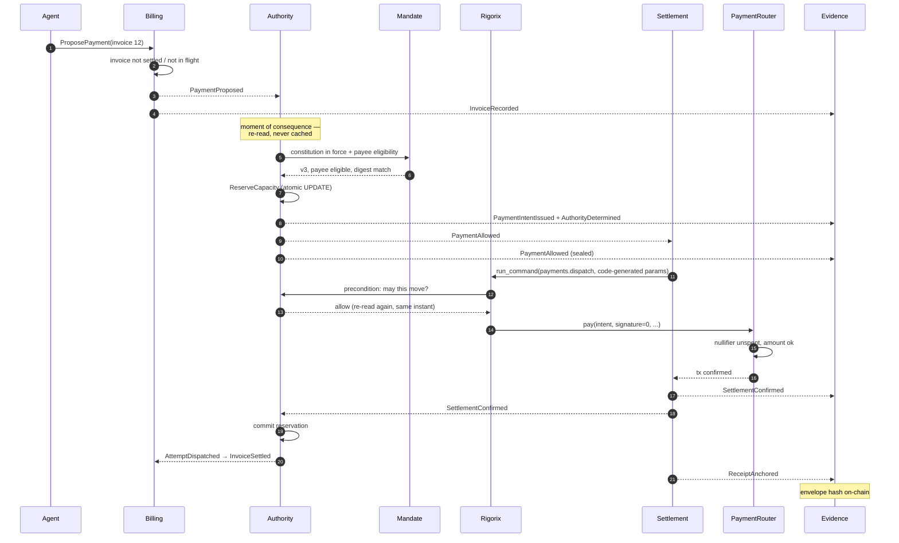
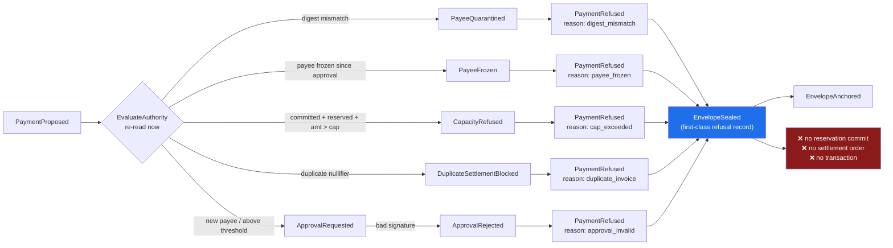

# Domain Event Flow

**Session:** 432050ea-0419-44ba-8ac4-b239242634b4
**Decisions:** ADR-003 (events), ADR-007 (enforcement locks)

## All events across bounded contexts

```mermaid
flowchart TD
    subgraph MANDATE["Mandate (core)"]
        M1[/"MandateCreated"/]
        M2[/"OwnerRegistered"/]
        M3[/"PayerEnrolled"/]
        M4[/"AgentAuthorised"/]
        M5[/"ConstitutionVersionPublished"/]
        M6[/"CapChanged"/]
        M7[/"ThresholdChanged"/]
        M8[/"PayeeRegistered"/]
        M9[/"PayeeDigestChanged"/]
        M10[/"PayeeQuarantined"/]
        M11[/"PayeeFrozen"/]
        M12[/"PayeeReapproved"/]
    end

    subgraph BILLING["Billing (supporting)"]
        B1[/"InvoiceRecorded"/]
        B2[/"DuplicateInvoiceDetected"/]
        B3[/"PaymentProposed"/]
        B4[/"ProposalRejected"/]
        B5[/"AttemptDispatched"/]
        B6[/"AttemptRefused"/]
        B7[/"InvoiceSettled"/]
    end

    subgraph AUTHORITY["Authority (core)"]
        A1[/"PaymentIntentIssued"/]
        A2[/"AuthorityDetermined"/]
        A3[/"PaymentAllowed"/]
        A4[/"PaymentRefused"/]
        A5[/"CapacityReserved"/]
        A6[/"CapacityRefused"/]
        A7[/"ApprovalRequested"/]
        A8[/"ApprovalGranted"/]
        A9[/"ApprovalRejected"/]
        A10[/"ApprovalExpired"/]
        A11[/"CapacityCommitted"/]
        A12[/"CapacityReleased"/]
    end

    subgraph SETTLEMENT["Settlement (core)"]
        S1[/"SettlementOrdered"/]
        S2[/"SettlementSubmitted"/]
        S3[/"SettlementConfirmed"/]
        S4[/"SettlementReverted"/]
        S5[/"DuplicateSettlementBlocked"/]
        S6[/"NullifierSpent"/]
        S7[/"ReceiptAnchored"/]
    end

    subgraph EVIDENCE["Evidence (supporting)"]
        E1[/"EnvelopeSealed"/]
        E2[/"EnvelopeAnchored"/]
        E3[/"EvidenceVerificationFailed"/]
    end

    subgraph CONSOLE["Console (generic)"]
        C1["read models<br/>(no events published)"]
    end

    %% Mandate → Authority / Billing / Settlement
    M5 --> A2
    M6 --> A2
    M7 --> A2
    M10 -->|"in-flight intent<br/>now ineligible"| A4
    M11 -->|"frozen before dispatch"| A4
    M8 --> A2
    M12 --> A2

    %% Billing → Authority
    B3 --> A1
    B1 -.->|"digest mismatch"| M9
    B2 -.->|"replay refused locally"| B6

    %% Authority internal
    A1 --> A2
    A2 --> A3
    A2 --> A4
    A2 --> A5
    A5 --> A6
    A3 --> A7
    A7 --> A8
    A7 --> A9
    A7 --> A10

    %% Authority → Settlement
    A3 -->|"may dispatch"| S1
    A8 -->|"may dispatch"| S1

    %% Settlement internal + back
    S1 --> S2
    S2 --> S3
    S2 --> S4
    S2 --> S5
    S3 --> S6
    S3 --> A11
    S4 --> A12
    S5 --> A4
    S3 --> B7
    S4 --> B6

    %% Everything → Evidence
    A2 --> E1
    A3 --> E1
    A4 --> E1
    A8 --> E1
    A9 --> E1
    A6 --> E1
    S3 --> E1
    S4 --> E1
    S5 --> E1
    B4 --> E1
    B6 --> E1
    M10 --> E1
    M11 --> E1
    E1 --> E2
    E2 -.->|"hash anchored"| S7

    %% Evidence → Console
    E2 --> C1
    A4 --> C1
    S3 --> C1
```

## The happy path (scenario 1: a normal bill auto-pays)

## The refusal path (scenarios 2, 3, 4 — no transaction, but proof)

**The claim being diagrammed:** every arrow on the refusal side ends in an envelope, and none
ends in a transaction. `AuthorityDetermined` is published *before* the verdict is acted on, so
a refusal cannot be lost by skipping the "uninteresting" branch.

## Event triage summary (ADR-008)

| Context | Events | Cross-boundary | Audit-required | Domain-expert-cares |
|---|---|---|---|---|
| Mandate | 12 | 9 | 12 | 11 |
| Billing | 7 | 6 | 7 | 6 |
| Authority | 12 | 10 | 12 | 11 |
| Settlement | 7 | 6 | 7 | 6 |
| Evidence | 3 | 3 | 3 | 3 |

Every event passes at least one triage question — no implementation details were promoted.

---

*Generated from session: 432050ea-0419-44ba-8ac4-b239242634b4*
*Date: 2026-11-13*