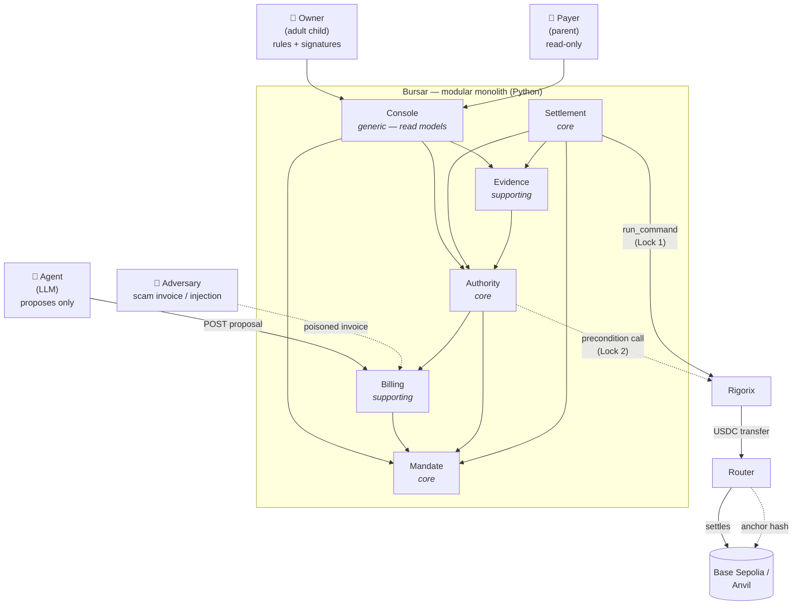
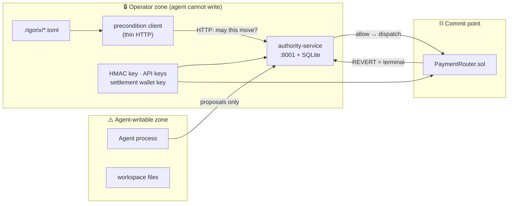
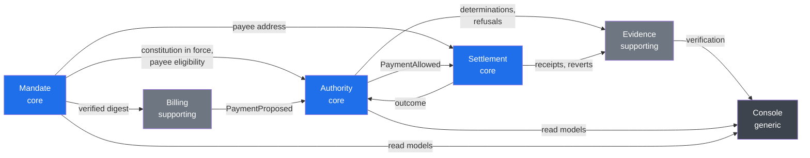

# System Context Diagram

**Session:** 432050ea-0419-44ba-8ac4-b239242634b4
**Status:** Accepted (see ADR-001)

## Context

Bursar is a delegated bill-paying agent for **one household**. An owner grants an AI agent a
signed, versioned mandate to pay a parent's recurring bills in USDC, while a machine-enforced
constitution and an on-chain second lock make it impossible for the agent — or a stolen
operator key — to pay the wrong payee, exceed the caps, or pay the same invoice twice.

## Actors

## Trust boundaries

**Reading this:** the agent can *ask* from the agent zone. It cannot write the config, cannot
reach the SQLite ledger, cannot hold the HMAC key, and cannot sign. The only path from a
proposal to money is `Authority allow → Rigorix dispatch → Router accept`.

## Deployment view

| Deployable | Port | Storage | CORS | Owns |
|---|---|---|---|---|
| `authority-service` | 8001 | `data/authority.db` | no | Authority |
| `console-api` | 8000 | `data/bursar.db` | yes (Vite origin) | Console, Mandate, Billing, Settlement, Evidence |
| `rigorix-server` | 8080 | its own | no | enforcement config + audit |
| React console | 5173 | — | — | UI |
| Anvil | 8545 | — | — | chain (demo) |

Rationale for the split: the agent's process must not be able to reach Authority's database or
its signing material (NFR-003). Everything else stays in one process to fit the timebox.

## Bounded Context Flow (summary)

Blue = core (full tactical DDD), grey = supporting (service depth), dark = generic (adapter).

## Core claim in one line

A payment can only exist if **Authority read the constitution at that instant**, **the owner
signed those exact bytes if required**, and **the chain had not seen that nullifier before**.
All three failures are refusals, and all three refusals are sealed as evidence.

---

*Generated from session: 432050ea-0419-44ba-8ac4-b239242634b4*
*Date: 2026-11-13*