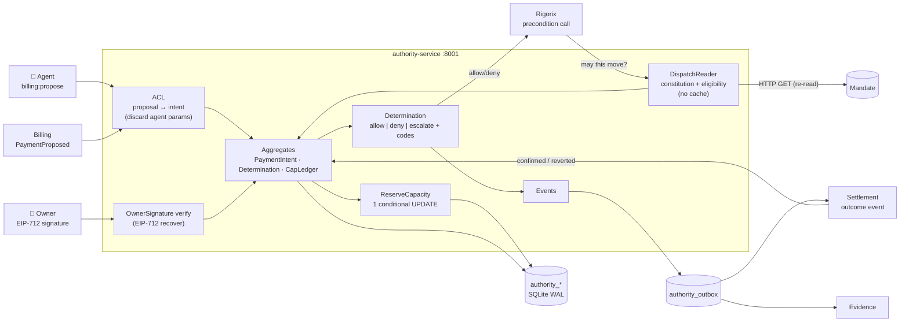
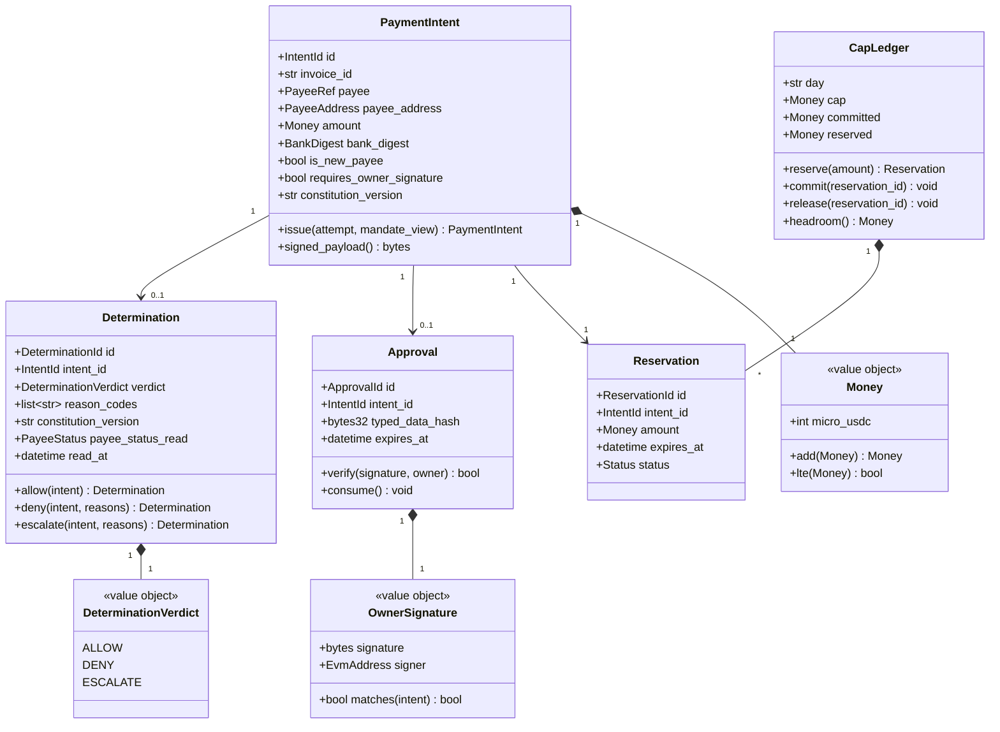
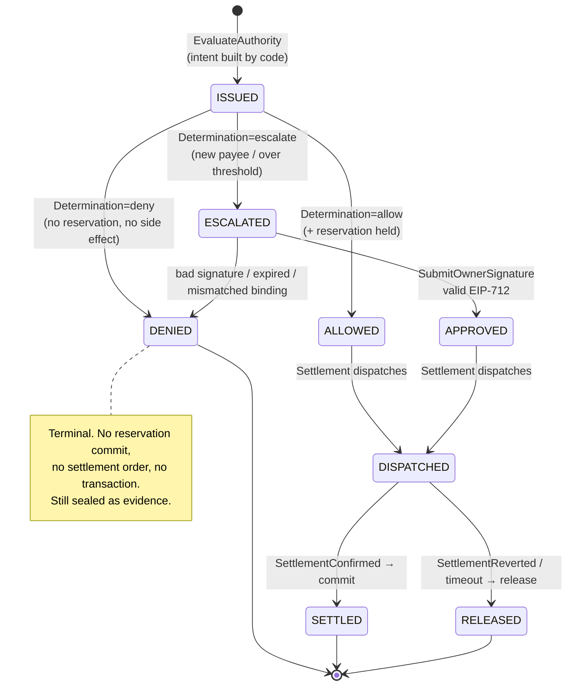
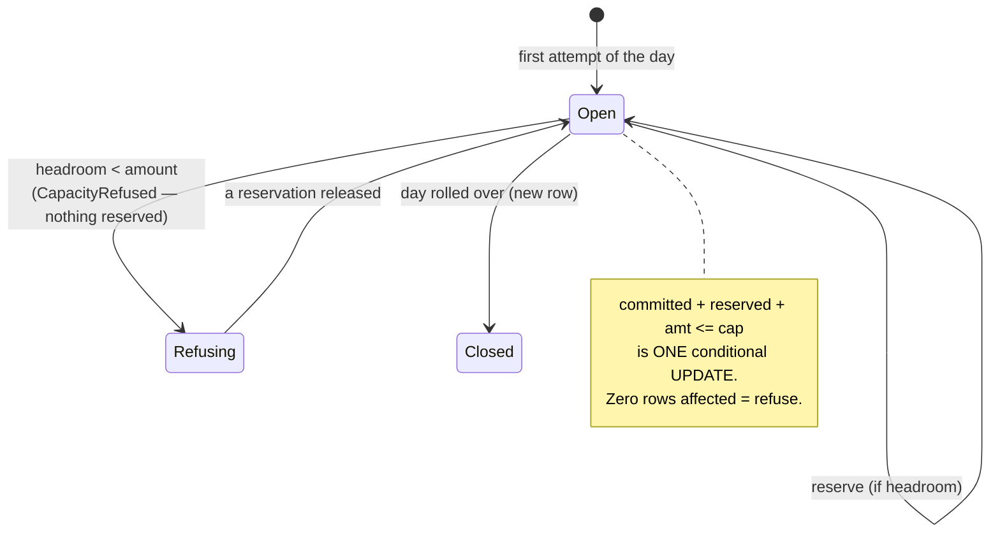
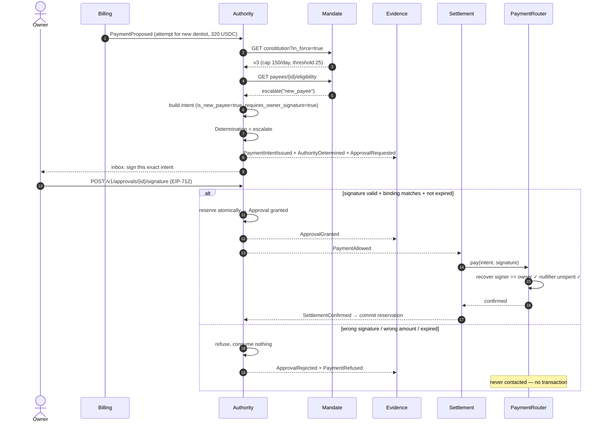

# Authority

## Module Status

**Status:** Planned
**Depends:** Mandate (constitution in force, payee eligibility), Billing (attempts)
**Used by:** Settlement, Evidence, Console
**Last reviewed:** 2026-11-13
**Source session:** 432050ea-0419-44ba-8ac4-b239242634b4

## Description

The decision engine and the system's heart. Turns an untrusted attempt into a `PaymentIntent`
with code-generated parameters, **re-reads** the in-force constitution and live payee state at
the moment of consequence, issues an `allow | deny | escalate` `Determination` with reason
codes, and holds atomic `Reservation`s against the daily cap until settlement resolves.

It runs as its **own FastAPI process** (`authority-service`, port 8001, `data/authority.db`)
outside the agent-writable workspace — that separation *is* the security claim (NFR-003).

**Modeling Depth:** tactical (core domain)
**Subdomain Rationale:** Contains the check-at-dispatch-time, atomic-reservation and exact-intent-binding invariants that make the agent safe.
**Context Map:** conformist → Mandate (Authority reads the in-force constitution version and live payee eligibility at dispatch time; re-read, never cached, per 'authority re-read at moment of consequence'.); anticorruption-layer → Billing (Attempts arrive as untrusted agent proposals; Authority translates them into PaymentIntents and discards agent-supplied amounts, addresses and command params.); Settlement → partnership (Settlement may only execute an order derived from an allow determination; both sides co-evolve around the intent_id contract and the commit-or-release outcome.); Evidence → open-host (Authority publishes determinations and refusals; Evidence consumes and seals them.); Console → anticorruption-layer (Console consumes read models and submits approvals; it cannot trigger a payment directly.)

## Architecture

| Layer | Responsibility |
|-------|--------------|
| **Domain** | Aggregates, entities, value objects, domain services, repository interfaces | `src/authority/domain/` |
| **Application** | Use cases / application services, DTOs, input validation | `src/authority/application/` |
| **Infrastructure** | Repository implementations, DB models, external clients | `src/authority/infrastructure/` |
| **Interfaces** | Precondition endpoint (Rigorix entry), REST handlers, event subscribers | `src/authority/interfaces/` |

Two interface scopes matter: `/v1/precondition/check` is the **enforcement entry** called by
Rigorix at Lock 2; `/v1/...` CRUD is for humans and the console. They must not share a handler.

## Contract Freeze

**Phase A artifact: [`docs/contracts/authority-contract-freeze.md`](../../docs/contracts/authority-contract-freeze.md).**

That file is the authoritative frozen surface for this context: the fifteen invariant ids (A-1…A-15) with the
illegal state each prevents, every signature (`PaymentIntent`, `Determination`, `CapLedger` + `Reservation`,
`Approval` + `OwnerSignature`, `Money`, `DeterminationVerdict`, the four repository ports, `MandateView` /
`AttemptViewPort`, and the five catalog application services), the two domain-service interfaces
(`DeterminationPolicy` / `ApprovalBinder`, `src/authority/domain/services.py`), the twelve event payload
schemas (`src/authority/domain/events.py`), the HTTP contract and error envelope (§2.9), the refusal
vocabulary, the ordered Phase-B work list, and the explicit out-of-scope table (no adapter or router
bodies, no migration, no EIP-712 signer implementation).

Status: frozen for implementation. `src/authority/` contains signatures only — every body raises
`NotImplementedError("A-n — see module doc")` — and the suites under `tests/unit/authority/` are red by
design, each naming the invariant it defends. `infrastructure/` and `interfaces/` are empty packages for
now; their bodies and the router arrive in Phase B. Verify with
`bash .pi/scripts/freeze.sh verify --module authority`.

## Related ADRs

| ADR | Relevance |
|---|---|
| [ADR-001](../decisions/ADR-001-architecture-pattern.md) | Authority is a separate process by security design, not by taste. |
| [ADR-002](../decisions/ADR-002-data-storage-strategy.md) | The cap invariant is a single conditional `UPDATE`, not read-then-write. |
| [ADR-003](../decisions/ADR-003-cross-context-communication.md) | Determinations and refusals are published events; Evidence consumes them. |
| [ADR-005](../decisions/ADR-005-authentication-authorization.md) | Owner EIP-712 signature is the only authority for escalations; agent key cannot sign. |
| [ADR-006](../decisions/ADR-006-cost-tracking-usage-metering.md) | `CapLedger` is the single spend truth; budget guard refuses with `BUDGET_EXHAUSTED`. |
| [ADR-007](../decisions/ADR-007-compliance-engine-architecture.md) | This module *is* Lock 2 of the enforcement engine. |

## Diagrams

### Data Flow



### Entity Relationship



### Aggregate State — PaymentIntent



### Aggregate State — CapLedger day



### Key Use Case Sequence — escalate then sign (scenario 5)



## Components

### Aggregate: PaymentIntent

Immutable, code-constructed. The exact bytes the owner signs and the contract verifies.

```python
# src/authority/domain/payment_intent.py
"""Canonical: .pi/architecture/modules/authority.md#aggregate-paymentintent
Reference: .pi/architecture/decisions/ADR-007-compliance-engine-architecture.md"""

from dataclasses import dataclass


@dataclass(frozen=True)
class PaymentIntent:
    """Immutable. Built only from Mandate-owned data + identifiers from the attempt."""

    id: IntentId
    invoice_id: str
    payee: PayeeRef
    payee_address: PayeeAddress  # from Mandate, never from the proposal
    amount: Money  # from the invoice via Billing, re-checked here
    bank_digest: BankDigest  # the VERIFIED digest, not the presented one
    is_new_payee: bool
    requires_owner_signature: bool
    constitution_version: str

    @classmethod
    def issue(
        cls, attempt: PaymentAttemptView, mandate: MandateView, invoice: InvoiceView
    ) -> "PaymentIntent":
        """ACL boundary: everything agent-supplied is discarded except the ids."""
        if not attempt.amount.equals(invoice.amount):  # A-3
            raise AmountMismatch(attempt.amount, invoice.amount)
        return cls(
            id=IntentId.new(),
            invoice_id=invoice.id,
            payee=invoice.payee,
            payee_address=mandate.verified_address(invoice.payee),  # A-2
            amount=invoice.amount,
            bank_digest=mandate.verified_digest(invoice.payee),  # A-2
            is_new_payee=mandate.is_new(invoice.payee),
            requires_owner_signature=(
                mandate.is_new(invoice.payee) or mandate.threshold.exceeded_by(invoice.amount)
            ),
            constitution_version=mandate.constitution_version,
        )

    def signed_payload(self) -> dict:
        """The EIP-712 message. One definition, consumed by Python AND Solidity."""
        return {
            "intentId": self.id.value,
            "invoiceId": self.invoice_id,
            "payee": self.payee.id,
            "payeeAddress": self.payee_address.value,
            "amountUsdc": self.amount.micro_usdc,
            "bankDigest": self.bank_digest.hash,
            "isNewPayee": self.is_new_payee,
            "requiresOwnerSignature": self.requires_owner_signature,
        }
```

**Invariants (aggregate-local):**
| # | Rule | Prevents |
|---|---|---|
| A-1 | An intent is immutable after issue; there is no setter and no `dict.update` merge. | Late mutation between authorization and signature. |
| A-2 | `payee_address` and `bank_digest` come from Mandate's verified record, never from the invoice or the proposal. | Prompt injection or a scam invoice substituting the destination. |
| A-3 | `amount` must equal the invoice amount; agent-supplied amount is not accepted. | Splitting one bill into edited-amount attempts to dodge the threshold. |
| A-4 | `requires_owner_signature` is derived (new payee OR amount > threshold), never passed in. | The agent waiving its own escalation. |

### Aggregate: Determination

Immutable record of judgement, including which rules were consulted and when.

```python
# src/authority/domain/determination.py
"""Canonical: .pi/architecture/modules/authority.md#aggregate-determination"""

@dataclass(frozen=True)
class Determination:
    id: DeterminationId
    intent_id: IntentId
    verdict: DeterminationVerdict
    reason_codes: tuple[str, ...]
    constitution_version: str
    payee_status_read: PayeeStatus
    read_at: datetime
    ledger_snapshot: Money          # committed+reserved at decision time

    @classmethod
    def deny(cls, intent: PaymentIntent, view: MandateView, reasons: list[str]) -> "Determination":
        if not reasons:
            raise DeterminationWithoutReason()      # A-7
        return cls(..., verdict=DeterminationVerdict.DENY, reason_codes=tuple(reasons), ...)
```

**Invariants:**
| # | Rule | Prevents |
|---|---|---|
| A-5 | A `DENY` carries at least one reason code from a closed set (`digest_mismatch`, `payee_quarantined`, `payee_frozen`, `cap_exceeded`, `duplicate_invoice`, `approval_invalid`, `budget_exhausted`, `amount_mismatch`). | Refusals that cannot be explained or asserted in tests. |
| A-6 | `constitution_version` and `payee_status_read` are recorded from the **same read** that produced the verdict, with `read_at`. | A determination justified by a version it never actually consulted. |
| A-7 | A determination cannot be constructed without a reason (deny) or without a version (always). | Silent or unjustified verdicts. |
| A-8 | A `DENY` produces no `Reservation` and no `PaymentAllowed`. | A refusal leaving a partial side effect. |

### Aggregate: CapLedger

The one aggregate that makes split-invoice structuring impossible.

```python
# src/authority/domain/cap_ledger.py
"""Canonical: .pi/architecture/modules/authority.md#aggregate-cap-ledge"""


@dataclass
class CapLedger(AggregateRoot):
    day: str  # ISO date in household timezone
    cap: Money
    committed: Money
    reserved: Money

    @property
    def headroom(self) -> Money:
        return self.cap - self.committed - self.reserved

    def try_reserve(self, intent: PaymentIntent) -> Reservation:
        """Atomicity is delegated to one conditional UPDATE in infrastructure (ADR-002)."""
        if self.headroom < intent.amount:  # A-9
            raise CapacityExceeded(needed=intent.amount, headroom=self.headroom)
        reservation = Reservation.hold(intent)
        self.reserved = self.reserved + intent.amount
        self.record(CapacityReserved(intent_id=intent.id, amount=intent.amount))
        return reservation

    def commit(self, reservation: Reservation) -> None:
        if reservation.status is not ReservationStatus.HELD:  # A-10
            raise ReservationAlreadyResolved(reservation.id)
        self.reserved = self.reserved - reservation.amount
        self.committed = self.committed + reservation.amount
        reservation.mark_committed()
        self.record(CapacityCommitted(...))

    def release(self, reservation: Reservation) -> None:
        if reservation.status is not ReservationStatus.HELD:  # A-10
            raise ReservationAlreadyResolved(reservation.id)
        self.reserved = self.reserved - reservation.amount
        reservation.mark_released()
        self.record(CapacityReleased(...))
```

**Invariants:**
| # | Rule | Prevents |
|---|---|---|
| A-9 | `committed + reserved + amount <= cap`, checked and applied as **one** conditional UPDATE. | Concurrent split attempts each seeing headroom and jointly overdrawing the cap (scenario 4). |
| A-10 | A reservation resolves **exactly once** — committed or released, never both, never twice. | Double-counting or losing money relative to the chain. |
| A-11 | `committed` never decreases within a day; only `reserved` moves back down. | Un-committing settled spend to free headroom. |
| A-12 | The day key is fixed per reservation; a rollover creates a new ledger row. | A late settlement landing in tomorrow's cap. |

### Entity: Reservation / Entity: Approval

`Reservation` is an entity inside the `CapLedger` aggregate (identity + lifecycle, no
independent existence). `Approval` is an entity in its own right because it outlives a request
cycle and carries the signature, nonce and expiry.

**Approval invariants (A-13…A-15):**
| # | Rule | Prevents |
|---|---|---|
| A-13 | An approval binds `intent_id` + `amount` + `payee_address` + `bank_digest`; any mismatch with the current intent invalidates it. | An approval for a 20 USDC bill replayed for a 320 USDC payment. |
| A-14 | An approval is single-use (`consume()` twice raises) and expires. | One owner signature dispatching two payments. |
| A-15 | The recovered signer must equal the mandate owner address; otherwise `ApprovalRejected`. | A signature from any other key, including the operator's. |

### Value Objects (entity-vs-VO justification)

| VO | Justification | Not an entity because |
|---|---|---|
| `Money` | USDC micro-units with explicit arithmetic; equality by amount. | Currency amounts have no identity — two equal amounts are interchangeable. |
| `OwnerSignature` | `(bytes, recovered signer)`; valid only against one intent. | It is a proof artifact, not a thing with a lifecycle. |
| `DeterminationVerdict` | Closed 3-value set. | An enum. |

### Repository interfaces (owned by `domain/`)

```python
# src/authority/domain/repositories.py
"""Canonical: .pi/architecture/modules/authority.md#components"""


class PaymentIntentRepository(ABC):
    @abstractmethod
    async def find_by_id(self, id_: IntentId) -> PaymentIntent | None: ...
    @abstractmethod
    async def save(self, intent: PaymentIntent) -> None: ...


class DeterminationRepository(ABC):
    @abstractmethod
    async def append(self, determination: Determination) -> None: ...
    @abstractmethod
    async def find_by_intent(self, intent_id: IntentId) -> Determination | None: ...


class CapLedgerRepository(ABC):
    @abstractmethod
    async def try_reserve_atomic(self, day: str, amount: Money, reservation: Reservation) -> bool:
        """Returns False when the conditional UPDATE matched no row (cap exceeded)."""

    @abstractmethod
    async def resolve(self, reservation_id: ReservationId, outcome: str) -> None: ...
    @abstractmethod
    async def ledger_for(self, day: str) -> CapLedger: ...


class ApprovalRepository(ABC):
    @abstractmethod
    async def find_by_id(self, id_: ApprovalId) -> Approval | None: ...
    @abstractmethod
    async def save(self, approval: Approval) -> None: ...
```

### Ports to upstream contexts (ACL)

```python
# src/authority/domain/ports.py
class MandateView(ABC):
    """Read-through port. Implementations MUST NOT cache (moment-of-consequence rule)."""

    @abstractmethod
    async def constitution_in_force(self, household_id) -> ConstitutionView: ...
    @abstractmethod
    async def eligibility(self, payee_id) -> Eligibility: ...
    @abstractmethod
    async def verified_address(self, payee_id) -> PayeeAddress: ...
    @abstractmethod
    async def verified_digest(self, payee_id) -> BankDigest: ...


class AttemptViewPort(ABC):
    """ACL from Billing: only ids and invoice amount survive."""

    @abstractmethod
    async def load(self, attempt_id) -> tuple[PaymentAttemptView, InvoiceView]: ...
```

The ACL implementation lives in `infrastructure/` and translates Billing's proposal into a
`PaymentAttemptView` that has **no** address, digest or cap fields at all — the agent's data
cannot leak because there is nowhere to put it.

### Domain Services

| Service | Why not on an aggregate |
|---|---|
| `DeterminationPolicy` | Composes constitution rules + payee eligibility + ledger headroom into a verdict; spans three aggregates and two contexts. |
| `ApprovalBinder` | Builds and verifies the EIP-712 typed data; the same spec generates Solidity (ADR-007). |

## Domain Events

| Event | Description | Trigger | Payload | Published By | Expert cares | Crosses boundary | Audit |
|---|---|---|---|---|---|---|---|
| `PaymentIntentIssued` | Code-constructed intent with the exact fields to be signed/enforced. | EvaluateAuthority | `intent_id, invoice_id, payee_id, payee_address, amount_usdc, bank_digest, is_new_payee, requires_owner_signature, constitution_version` | Authority | ✅ | ✅ | ✅ |
| `AuthorityDetermined` | Verdict with reason codes and version consulted at dispatch time. | EvaluateAuthority | `determination_id, intent_id, verdict, reason_codes, constitution_version, payee_status, read_at` | Authority | ✅ | ✅ | ✅ |
| `PaymentAllowed` | The only event that authorises dispatch. | EvaluateAuthority | `intent_id, amount_usdc, reservation_id` | Authority | ✅ | ✅ | ✅ |
| `PaymentRefused` | Refusal with reason (`digest_mismatch`, `payee_frozen`, `cap_exceeded`, `duplicate_invoice`, `approval_invalid`, `budget_exhausted`). | EvaluateAuthority, SubmitOwnerSignature, ReconcileReservation | `intent_id, reason_codes, refused_at` | Authority | ✅ | ✅ | ✅ |
| `CapacityReserved` | Amount held against the daily cap. | ReserveCapacity | `day, reservation_id, intent_id, amount_usdc, committed, reserved` | Authority | ✅ | ❌ | ✅ |
| `CapacityRefused` | Headroom insufficient; nothing reserved. | ReserveCapacity | `day, intent_id, amount_usdc, headroom` | Authority | ✅ | ✅ | ✅ |
| `ApprovalRequested` | Escalation opened a signature request bound to one intent. | EscalateForSignature | `approval_id, intent_id, typed_data_hash, expires_at, reason` | Authority | ✅ | ✅ | ✅ |
| `ApprovalGranted` | Owner signature verified against the bound intent. | SubmitOwnerSignature | `approval_id, intent_id, signer` | Authority | ✅ | ✅ | ✅ |
| `ApprovalRejected` | Invalid signature, wrong signer, or binding mismatch; no side effect. | SubmitOwnerSignature | `approval_id, intent_id, reason` | Authority | ✅ | ✅ | ✅ |
| `ApprovalExpired` | Signature window closed; owner must re-sign a fresh intent. | SubmitOwnerSignature | `approval_id, intent_id, expired_at` | Authority | ❌ | ❌ | ✅ |
| `CapacityCommitted` | Reservation became committed spend after settlement. | ReconcileReservation | `day, reservation_id, intent_id, amount_usdc, committed` | Authority | ✅ | ❌ | ✅ |
| `CapacityReleased` | Reservation released; headroom returns. | ReconcileReservation | `day, reservation_id, intent_id, amount_usdc, reason` | Authority | ✅ | ❌ | ✅ |

## Application Services

| Service | Use case | Maps to FR |
|---------|----------|-----------|
| `EvaluateAuthority` | The core decision: builds a payment intent from the attempt, re-reads the in-force constitution and live payee state, and issues allow, deny or escalate with reasons. | FR-011 |
| `ReserveCapacity` | Atomically reserves amount against the daily cap so committed plus reserved never exceeds it; refuses rather than over-books. | FR-013 |
| `EscalateForSignature` | Converts an escalate determination into a signature request bound to the exact intent id, amount, address and bank digest. | FR-014 |
| `SubmitOwnerSignature` | Verifies the owner's EIP-712 signature against the exact bound intent and either authorises dispatch or refuses without side effect. | FR-015 |
| `ReconcileReservation` | Commits or releases a reservation according to the settlement outcome so the cap ledger matches the chain. | FR-017 |

Supporting handlers below the catalog: `GetDetermination`, `ListApprovals`,
`PreconditionCheck` (the Lock-2 entrypoint, which composes `EvaluateAuthority` + `ReserveCapacity`).

`PreconditionCheck` deserves naming: it is deliberately **not** a new application service, it is
the enforcement-shaped façade over the two catalog services, and it fails closed.

## API Endpoints

| Method | Path | Handler | Input | Output | Auth |
|---|---|---|---|---|---|
| POST | `/v1/precondition/check` | `interfaces/precondition.check` | run_command params (intent_id, invoice_id, payee, payee_address, amount_usdc, bank_digest, is_new_payee, requires_owner_signature) | `{decision, reason_codes, determination_id}` — non-200 fails closed | internal (Rigorix precondition client, mTLS-less local token) |
| POST | `/v1/attempts/{attempt_id}/evaluate` | `interfaces/api.evaluate` | attempt_id | determination | `authority:evaluate` (agent allowed) |
| GET | `/v1/intents/{id}` | `interfaces/api.get_intent` | — | intent | `authority:read` |
| GET | `/v1/intents/{id}/determination` | `interfaces/api.get_determination` | — | verdict + reason codes + version + read_at | `authority:read` |
| GET | `/v1/ledger/{day}` | `interfaces/api.get_ledger` | — | cap, committed, reserved, headroom | `authority:read` |
| GET | `/v1/approvals` | `interfaces/api.list_approvals` | `?status=pending` | inbox items | `authority:read` (owner) |
| POST | `/v1/approvals/{id}/signature` | `interfaces/api.submit_signature` | EIP-712 signature | `granted` / `rejected` | `authority:sign` + signature |
| POST | `/v1/settlements/{id}/outcome` | `interfaces/api.reconcile` | `confirmed` / `reverted` | ledger state | `settlement:read` (internal) |

## Ubiquitous Language

| Term | Definition |
|------|-----------|
| payment intent | The code-constructed, immutable description of one payment: intent id, invoice id, payee, payee address, amount, bank digest, is_new_payee, requires_owner_signature. The unit of authority and of signature binding. |
| determination | The allow/deny/escalate verdict for one intent, produced at dispatch time against the in-force constitution and live payee state, with reason codes. |
| reservation | An atomic hold of amount against the daily cap for one intent; committed or released exactly once after settlement resolves. |
| approval | An owner EIP-712 signature over an intent's exact fields; single-use, expiring, and invalid the moment the intent changes. |
| escalate | The verdict for a payment that is not refused but cannot proceed without the owner: new payee or above threshold. |
| moment of consequence | The instant a precondition check is bound to the dispatch. Authority must re-read all external state here, not at plan time. |
| committed | Spend that has been confirmed on-chain and permanently counts against the day's cap. |
| release | Returning reserved capacity to the ledger because the payment provably did not happen. Never a rollback of committed spend. |
| is_new_payee | Flag on the intent, derived from Mandate's payee status, that forces escalation regardless of amount. |
| requires_owner_signature | Flag on the intent that the contract also checks on-chain; the off-chain determination and the contract must agree. |

## Dependencies

### Depends On

| Module | What it provides |
|---|---|
| **Mandate** | In-force constitution (cap, threshold, flags) and per-payee `eligibility()`, verified address and digest — **read-through, never cached**. |
| **Billing** | The attempt and its invoice amount, behind an ACL that exposes no routing fields. |

### Used By

| Consumer | What it needs |
|---|---|
| **Settlement** | `PaymentAllowed` / `ApprovalGranted` as the dispatch gate; the `intent_id` contract. |
| **Evidence** | All determinations and refusals for enveloping. |
| **Console** | Approval inbox and determination read models; `POST /signature` is the only write it may perform here. |

## Implementation Sequence

1. Shared kernel: `Money`, `AggregateRoot`, `DomainEvent`, EIP-712 spec file (`shared/eip712.py`).
2. `PaymentIntent` + `Determination` with A-1…A-8 (no I/O; pure tests).
3. `CapLedger` + `Reservation` with A-9…A-12, plus the conditional-UPDATE repository and a
   6-way concurrency test (scenario 4) — do this **before** any UI work.
4. `Approval` + `OwnerSignature` verification A-13…A-15, including expiry and single-use.
5. `MandateView` / `AttemptViewPort` adapters (read-through, no cache) + contract tests.
6. `EvaluateAuthority`, `ReserveCapacity` (catalog order), then `EscalateForSignature`,
   `SubmitOwnerSignature`, `ReconcileReservation`.
7. `interfaces/precondition.check` fail-closed behaviour + Rigorix integration test.
8. Wire Settlement outcome events into `ReconcileReservation`.
9. Budget guard (`BUDGET_EXHAUSTED`) per ADR-006.

## Patterns & OOP Mapping

| Component | Pattern | Rationale |
|---|---|---|
| `PaymentIntent.issue` | **Factory + Anti-Corruption Layer** | Only legal construction path; the ACL view type has no agent-controlled fields to copy. |
| `DeterminationPolicy` | **Specification (composed)** | Independent rules (digest match, eligibility, headroom, duplicate) combine; each is testable alone and the verdict carries which ones fired. |
| `MandateView` / `AttemptViewPort` | **Ports & Adapters** | Authority owns the port; infrastructure adapts HTTP/repository. Enables no-cache contract testing. |
| `CapLedger.try_reserve` | **Optimistic concurrency via conditional UPDATE** | The invariant is enforced by the database, not by application-time checking. |
| `Approval` / `OwnerSignature` | **Capability value object** | Possession of a valid signature is the only escalation authority; there is no flag to set. |
| Domain events → Evidence | **Observer (outbox)** | Refusals must be observed even on the failure path. |
| `Determination` | **Immutable record / DTO with behaviour** | Frozen dataclass; no setters, so history cannot be rewritten. |

OOP discipline: aggregates expose intention methods (`ledger.try_reserve(intent)`) and never
leak mutable state; no `set_verdict`; queries (`headroom`, `signed_payload`) are separate from
commands (CQS). `DeterminationPolicy` is a stateless function-object, not a god service.

Deliberately **not** introduced: a rule-engine DSL (a dict of predicates is enough), a
`Verdict` class hierarchy (three values), an event-sourcing store for intents (audit lives in
Evidence).

## Acceptance Criteria

| # | Component | Criterion | Verify In |
|---|---|---|---|
| 1 | `PaymentIntent.issue` | A proposal carrying its own `payee_address` cannot influence the intent: the intent uses Mandate's address and the test asserts inequality. | unit |
| 2 | `PaymentIntent.issue` | Attempt amount ≠ invoice amount → `AmountMismatch`, no intent persisted. | unit |
| 3 | `requires_owner_signature` | True for a new payee at 5 USDC and for an eligible payee at 320 USDC with threshold 25; false for eligible at 12 USDC. | unit |
| 4 | `CapLedger` cap | 6 concurrent 25 USDC attempts against a 150 USDC cap: exactly 6 reserve if headroom allows, else the excess returns `CapacityRefused` and the ledger never exceeds 150. (scenario 4) | integration (concurrency) |
| 5 | `CapLedger.commit/release` | Committing twice raises; commit then release raises; `committed + reserved` unchanged by a rejected second call. | unit |
| 6 | Determination reasons | Every `DENY` has ≥1 code from the closed set; a code outside the set fails type check. | unit |
| 7 | Re-read rule | Freeze the payee between evaluate and precondition check → precondition returns deny/`payee_frozen` and no settlement order exists. (scenario 3) | integration |
| 8 | `Approval` binding | Signature over intent A replayed for intent B (different amount) → `ApprovalRejected`, no dispatch. (scenario 5 negative) | integration |
| 9 | `Approval` single-use | Second `consume()` → raises; only one settlement event observed. | unit |
| 10 | Approvals expire | Past `expires_at` → `ApprovalExpired`, `PaymentRefused(approval_invalid)`. | unit |
| 11 | Precondition fail-closed | Mandate unreachable → `POST /v1/precondition/check` returns non-200 and Rigorix does not run the command. | integration |
| 12 | Refusal has no side effect | After any `PaymentRefused`, `reserved` and `committed` for the day are unchanged and no `settlement_orders` row exists. | integration |
| 13 | Ledger consistency | `committed` equals the sum of on-chain settled amounts for the day after a full scenario run. | integration |
| 14 | No LLM | `src/authority/` imports no model/LLM client (import-graph test). | automated |
| 15 | Layer purity | `src/authority/domain/` imports no FastAPI/SQLAlchemy/httpx. | automated |

## Modeling Depth Note (ADR-008)

**Core subdomain — full tactical depth.** Three aggregate roots (`PaymentIntent`,
`Determination`, `CapLedger`), two entities (`Reservation`, `Approval`), three value objects,
two domain services, five catalog application services, twelve triaged events, and
`domain/`-owned repository interfaces. Cross-context access goes through explicitly
documented ports (ACL to Billing, conformist read to Mandate).

## Open Questions

- Reservation TTL: a pending signature holds capacity forever without an expiry. Proposal: TTL =
  approval expiry; needs a decision before scenario 5 is demoed twice.
- Does a revert release immediately or after a reconciliation sweep? Implemented as immediate on
  `SettlementReverted`, sweep as backstop.

---

**Canonical:** `.pi/architecture/modules/authority.md`
**Last updated:** 2026-11-13