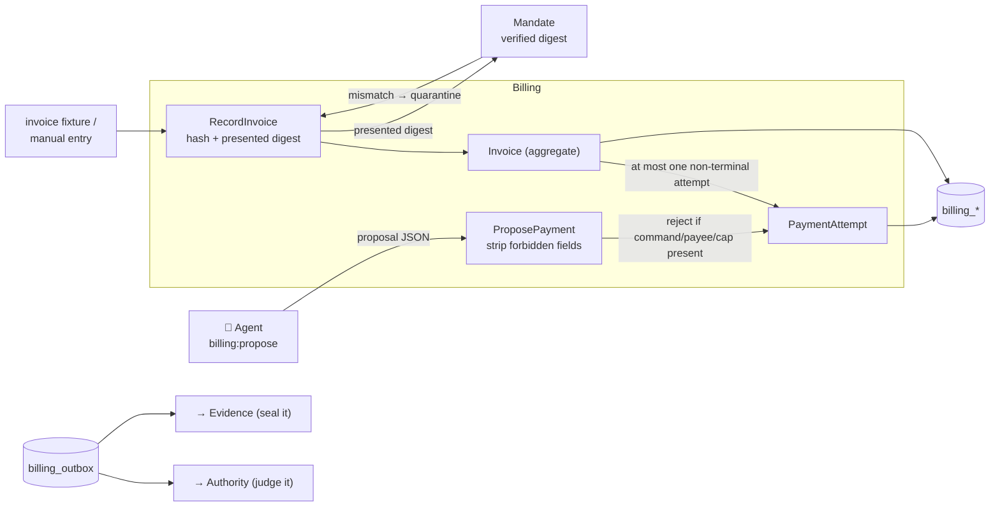
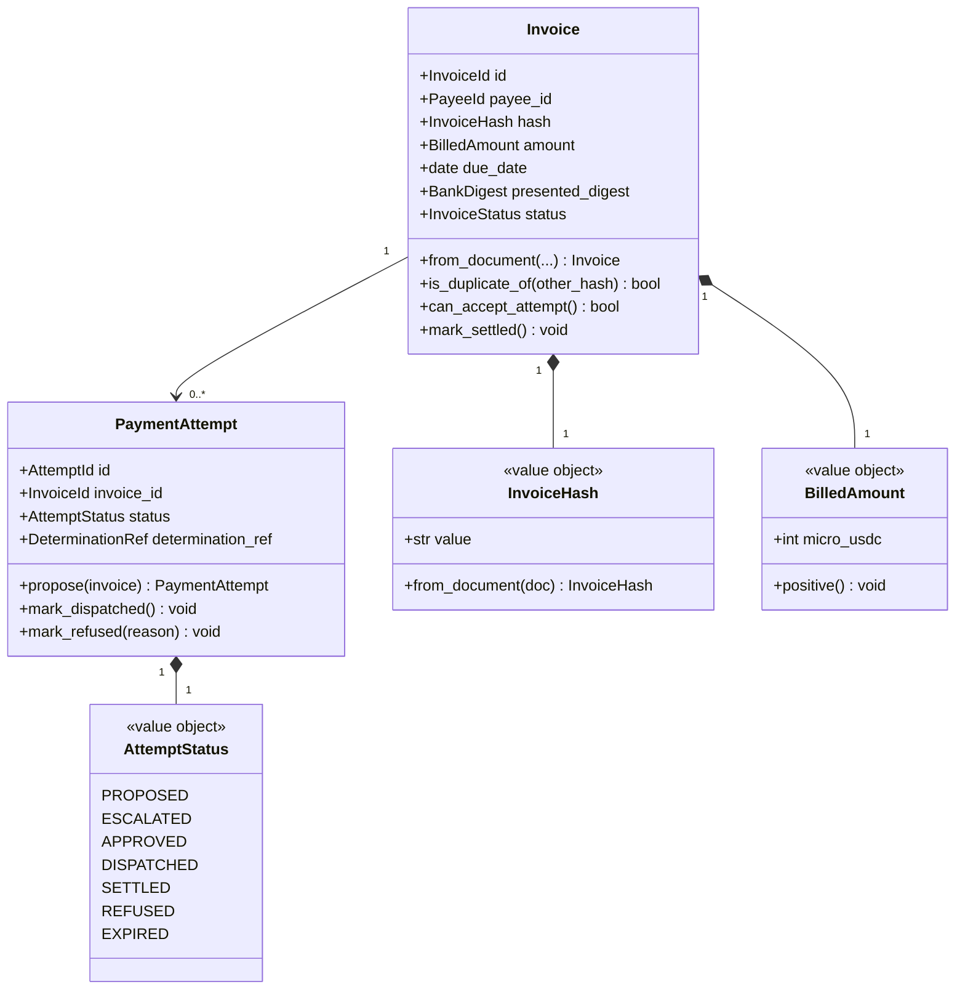
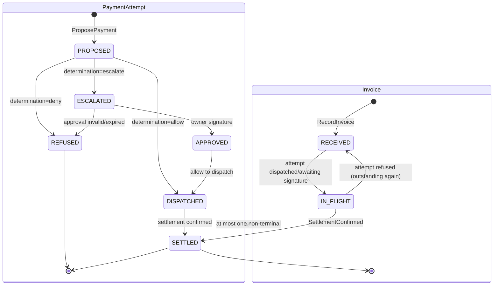
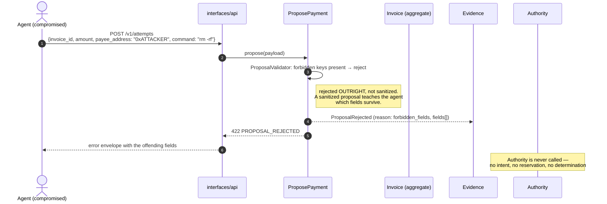

# Billing

## Module Status

**Status:** Planned
**Depends:** Mandate (payee id + verified digest baseline)
**Used by:** Authority, Evidence, Console
**Last reviewed:** 2026-11-13
**Source session:** 432050ea-0419-44ba-8ac4-b239242634b4

## Description

The demand side of the domain: invoices as documents, and payment attempts as the agent's only
legal output. Billing owns **what is owed** and **what the agent proposed**; it never decides
whether a payment is allowed.

Its real job is defensive: make proposals untrusted, structured and non-duplicable before they
ever reach Authority.

**Modeling Depth:** service (supporting subdomain)
**Subdomain Rationale:** Necessary input to the story, but it is bookkeeping over documents; no unique enforcement logic.
**Context Map:** Authority → anticorruption-layer (Attempts arrive as untrusted agent proposals; Authority translates them into PaymentIntents and discards agent-supplied amounts, addresses and command params.); conformist → Mandate (Invoices reference a Mandate-issued payee id and present a bank digest for comparison; invoice text is never authoritative for routing.)

## Architecture

| Layer | Responsibility |
|-------|--------------|
| **Domain** | `Invoice`, `PaymentAttempt`, `InvoiceHash`, `BilledAmount`, `AttemptStatus` (as captured), repository interfaces | `src/billing/domain/` |
| **Application** | `RecordInvoice`, `ProposePayment` | `src/billing/application/` |
| **Infrastructure** | SQLAlchemy repositories, invoice-hash computation, fixture loader | `src/billing/infrastructure/` |
| **Interfaces** | REST handlers, Mandate digest-review call, event publishers | `src/billing/interfaces/` |

## Contract Freeze

**Phase A artifact: [`docs/contracts/billing-contract-freeze.md`](../../docs/contracts/billing-contract-freeze.md).**

That file is the authoritative frozen surface for this context: the seven invariant ids (B-1…B-7) with
the illegal state each prevents, every signature (`Invoice`, `PaymentAttempt`, `InvoiceHash`,
`BilledAmount`, `InvoiceStatus`, `AttemptStatus`, the two repository ports, `RecordInvoice`,
`ProposePayment`), the seven event payload schemas (`src/billing/domain/events.py`), the two domain
ports (`src/billing/domain/ports.py`), the refusal vocabulary with its HTTP statuses, and the ordered
list of behaviour Phase B must implement.

Status: frozen for implementation. `src/billing/` contains signatures only — every body raises
`NotImplementedError("B-n — see module doc")` — and the 10 suites under `tests/unit/billing/` are red
by design, each naming the invariant it defends. Verify with
`bash .pi/scripts/freeze.sh verify --module billing`.

## Related ADRs

| ADR | Relevance |
|---|---|
| [ADR-001](../decisions/ADR-001-architecture-pattern.md) | Billing is a supporting context inside `console-api`; it may not import Authority. |
| [ADR-002](../decisions/ADR-002-data-storage-strategy.md) | `billing_*` tables; invoice-hash uniqueness is the local duplicate lock. |
| [ADR-003](../decisions/ADR-003-cross-context-communication.md) | Publishes `InvoiceRecorded`, `PaymentProposed`; consumes `SettlementConfirmed`. |
| [ADR-004](../decisions/ADR-004-api-design.md) | `Idempotency-Key` on `POST /v1/attempts` so a double-click is one attempt. |
| [ADR-005](../decisions/ADR-005-authentication-authorization.md) | The agent holds `billing:propose` and nothing else. |

## Diagrams

### Data Flow



### Entity Relationship



### Aggregate State — Invoice / PaymentAttempt



### Key Use Case Sequence — agent proposal with a smuggled field



## Components

Service-depth persistence contract (no elaborated aggregates beyond what the exploration
captured — see the Modeling Depth Note).

### Invoice

```python
# src/billing/domain/invoice.py
"""Canonical: .pi/architecture/modules/billing.md#components-invoice"""


@dataclass
class Invoice(AggregateRoot):
    id: InvoiceId
    payee_id: PayeeId
    hash: InvoiceHash  # duplicate key AND nullifier seed
    amount: BilledAmount
    due_date: date
    presented_digest: BankDigest  # NEVER authoritative for routing
    status: InvoiceStatus

    def can_accept_attempt(self) -> bool:
        """B-1 / B-2 live here."""
        return self.status in (InvoiceStatus.RECEIVED, InvoiceStatus.OUTSTANDING)

    def mark_settled(self) -> None:
        if self.status is InvoiceStatus.SETTLED:
            raise InvoiceAlreadySettled(self.id)  # B-2
        self.status = InvoiceStatus.SETTLED
        self.record(InvoiceSettled(invoice_id=self.id, hash=self.hash))
```

**Invariants:** B-1 at most one non-terminal attempt per invoice; B-2 a settled invoice is
closed forever; B-3 an invoice hash identifies the bill (second identical hash = same invoice);
B-4 `presented_digest` is stored for comparison only and never used for routing.

### PaymentAttempt

```python
# src/billing/domain/payment_attempt.py
FORBIDDEN_PROPOSAL_KEYS = frozenset(
    {
        "command",
        "command_path",
        "payee_address",
        "cap",
        "threshold",
        "constitution_version",
        "requires_owner_signature",
        "is_new_payee",
    }
)


@dataclass
class PaymentAttempt(AggregateRoot):
    id: AttemptId
    invoice_id: InvoiceId
    status: AttemptStatus

    @classmethod
    def from_proposal(cls, payload: dict, invoice: Invoice) -> "PaymentAttempt":
        offending = FORBIDDEN_PROPOSAL_KEYS & payload.keys()
        if offending:  # B-5
            raise ProposalRejected(sorted(offending))
        if not invoice.can_accept_attempt():  # B-1 / B-2
            raise InvoiceNotPayable(invoice.status)
        attempt = cls(AttemptId.new(), invoice.id, AttemptStatus.PROPOSED)
        attempt.record(
            PaymentProposed(attempt_id=attempt.id, invoice_id=invoice.id, amount=invoice.amount)
        )
        return attempt
```

**Invariants:** B-5 a proposal supplying a command path, payee address, cap or threshold is
**rejected outright, not sanitized**; B-6 amount must be positive USDC and equal the invoice
amount; B-7 only an allow/escalate determination moves an attempt toward dispatch — a refusal
leaves it terminal with no side effect.

### Persistence contract

| Table | Key | Notable constraints |
|---|---|---|
| `billing_invoices` | `id` | `UNIQUE(hash)` — local duplicate lock (B-3) |
| `billing_attempts` | `id` | `UNIQUE(invoice_id) WHERE status NOT IN ('refused','settled')` (partial index — B-1) |
| `billing_outbox` | `event_id` | append-only |

### Ports

| Port | Adapter | Note |
|---|---|---|
| `DigestReviewPort` | `MandateHttpAdapter` | Sends a presented digest to Mandate so it can quarantine (the scam path). |
| `InvoiceDocumentParser` | fixture-based adapter | Structured fixtures for the 7 scenarios; PDF extraction is explicitly a stretch item. |

## Domain Events

| Event | Description | Trigger | Payload | Published By | Expert cares | Crosses boundary | Audit |
|---|---|---|---|---|---|---|---|
| `InvoiceRecorded` | A bill entered the system with hash, amount and presented digest. | RecordInvoice | `invoice_id, payee_id, hash, amount_usdc, due_date, presented_digest` | Billing | ✅ | ✅ | ✅ |
| `DuplicateInvoiceDetected` | A known invoice hash arrived again; not new demand. | RecordInvoice | `invoice_id, hash, original_invoice_id` | Billing | ✅ | ✅ | ✅ |
| `PaymentProposed` | The agent produced a structured attempt; the request Authority must judge. | ProposePayment | `attempt_id, invoice_id, payee_id, amount_usdc` | Billing | ✅ | ✅ | ✅ |
| `ProposalRejected` | Proposal was malformed or carried forbidden fields; no determination requested. | ProposePayment | `attempt_id?, offending_fields, reason` | Billing | ✅ | ✅ | ✅ |
| `AttemptDispatched` | Attempt moved to dispatched after an allow determination (lifecycle only). | DispatchPayment | `attempt_id, invoice_id, intent_id` | Billing | ❌ | ✅ | ✅ |
| `InvoiceSettled` | Invoice closed as paid; cannot generate more attempts. | SettleOnce | `invoice_id, hash, tx_hash` | Billing | ✅ | ✅ | ✅ |
| `AttemptRefused` | Attempt ended refused; invoice returns to outstanding. | EvaluateAuthority | `attempt_id, invoice_id, reason_codes` | Billing | ✅ | ✅ | ✅ |

## Application Services

| Service | Use case | Maps to FR |
|---------|----------|-----------|
| `RecordInvoice` | Registers an invoice with amount, due date, invoice hash and the bank digest as presented, without trusting it for routing. | FR-007 |
| `ProposePayment` | Translates an agent proposal into a structured payment attempt, rejecting any agent-supplied routing or policy field. | FR-009 |

Below the catalog: `ListInvoices`, `GetAttempt`, `LoadFixtures` (demo seeding).

## API Endpoints

| Method | Path | Handler | Input | Output | Auth |
|---|---|---|---|---|---|
| POST | `/v1/invoices` | `interfaces/api.record_invoice` | payee_id, amount, due_date, document, presented routing details | invoice + hash | `mandate:write` (owner) or `billing:propose` (fixture seed) |
| GET | `/v1/invoices` | `interfaces/api.list_invoices` | `?status=&cursor=` | invoices | `console:read` |
| GET | `/v1/invoices/{id}` | `interfaces/api.get_invoice` | — | invoice | `console:read` |
| POST | `/v1/attempts` | `interfaces/api.propose` | `{invoice_id}` only | attempt or 422 `PROPOSAL_REJECTED` | `billing:propose` (**agent**) |
| GET | `/v1/attempts/{id}` | `interfaces/api.get_attempt` | — | attempt + status | `console:read` |

`POST /v1/attempts` accepts `invoice_id` and an optional `proposed_amount_micro_usdc` — and nothing
else. Every other field in the documented schema is rejected with `PROPOSAL_REJECTED` (HTTP 422)
rather than ignored — the difference between "we filter" and "we do not accept" is the whole ACL
argument. The amount is optional only so B-6 is reachable over the wire; when present it must equal
the invoice amount (`AMOUNT_MISMATCH`, HTTP 409).

## Ubiquitous Language

| Term | Definition |
|------|-----------|
| invoice | A bill document presented for payment, identified by its content hash, carrying amount, due date and a presented bank digest that is never authoritative for routing. |
| invoice hash | Canonical content hash of an invoice. Serves as the duplicate key off-chain and the nullifier seed on-chain. |
| payment attempt | The agent's structured proposal to pay one invoice. Exists only to be judged; it carries no authority and cannot dispatch itself. |
| agent proposal | When the agent submits, the only accepted shape is a payment attempt; anything else is a proposal rejection, not a negotiation. |
| in-flight | The invoice already has an attempt that has been dispatched or is awaiting signature; a second attempt is refused locally. |
| presented bank digest | The digest of routing details as they appear on the invoice. Compared against Mandate's verified digest; mismatch means quarantine. |
| split invoices | One real obligation broken into several invoices each below the threshold. Detected by the aggregate daily cap, not by per-invoice heuristics. |

## Dependencies

### Depends On

| Module | What it provides |
|---|---|
| **Mandate** | Payee id and verified digest baseline; the digest-review endpoint that triggers quarantine (conformist). |

### Used By

| Consumer | What it needs |
|---|---|
| **Authority** | The attempt + invoice amount, through an ACL that exposes no routing fields (anticorruption-layer). |
| **Evidence** | `InvoiceRecorded`, `PaymentProposed`, `ProposalRejected` to envelope. |
| **Console** | Invoice/attempt read models. |

## Implementation Sequence

1. `InvoiceHash`, `BilledAmount`, `AttemptStatus` value objects.
2. `Invoice` + `PaymentAttempt` with B-1…B-7; partial unique index migration.
3. Repository interfaces + SQLAlchemy implementations (with `UNIQUE(hash)`).
4. `RecordInvoice` (including duplicate detection + digest review call to Mandate).
5. `ProposePayment` with `ProposalRejected` for forbidden keys.
6. Fixture loader covering all 7 acceptance scenarios.
7. Event subscribers: `SettlementConfirmed` → `InvoiceSettled`; refusal → `AttemptRefused`.

## Patterns & OOP Mapping

| Component | Pattern | Rationale |
|---|---|---|
| `PaymentAttempt.from_proposal` | **Factory with allow-list** | Rejection-not-sanitization enforced at the only construction site. |
| `Invoice.can_accept_attempt` | **Guard / tell-don't-ask** | Callers ask the aggregate, never inspect `status` themselves. |
| `FORBIDDEN_PROPOSAL_KEYS` | **Declarative policy constant** | One list, testable, auditable — a set literal beats a validator class tree here. |
| `DigestReviewPort` | **Port + ACL** | Billing reports facts to Mandate without knowing what quarantine means. |

No aggregate/VO elaboration beyond the captured five types; no domain services invented.

## Acceptance Criteria

| # | Component | Criterion | Verify In |
|---|---|---|---|
| 1 | `InvoiceHash` | Same document → same hash; one changed character → different hash. | unit |
| 2 | Duplicate invoice | Recording the same hash twice yields the original invoice + `DuplicateInvoiceDetected`, no second row. | integration |
| 3 | At most one attempt | Two concurrent proposals for one invoice → exactly one `PaymentAttempt`; second gets `InvoiceNotPayable`. | integration (concurrency) |
| 4 | Forbidden fields | Proposal with `payee_address`, `command`, `cap` or `threshold` → 422 `PROPOSAL_REJECTED`, zero attempts persisted. | integration |
| 5 | Settled invoice | Proposal against a settled invoice → refused; no attempt row. (scenario 6, app layer) | integration |
| 6 | Digest review | An invoice whose presented digest ≠ Mandate's verified digest triggers Mandate quarantine and the attempt is refused downstream. (scenario 2) | integration |
| 7 | Refusal path | A denied determination sets the attempt `REFUSED` and the invoice back to outstanding, with no reservation committed. | integration |
| 8 | Layer purity | `src/billing/domain/` imports no FastAPI/SQLAlchemy/httpx. | automated |

## Modeling Depth Note (ADR-008)

This bounded context is a **supporting subdomain** — model at service/CRUD depth.
Keep implementation to application services + persistence. Do NOT introduce new
aggregates, value objects, or domain events beyond what this exploration captured.

**Anti-corruption edges:**
- Authority anticorruption-layer Billing — Attempts arrive as untrusted agent proposals; Authority translates them into PaymentIntents and discards agent-supplied amounts, addresses and command params.
- Billing conformist Mandate — Invoices reference a Mandate-issued payee id and present a bank digest for comparison; invoice text is never authoritative for routing.

Concretely: the five captured types stay as captured; there is no `InvoiceLine`, no domain
service, and no event beyond the seven listed. Behavior is limited to what the two catalog
application services need.

## Open Questions

- Invoice ingestion: fixtures only for the hackathon (documented). PDF/OCR extraction is a
  stretch item and must not enter the critical path.
- Should `InvoiceRecorded` for a *quarantined* payee be refused at record time, or recorded and
  refused at plan time? Current model records it (evidence of the attempt matters) and refuses
  later — this matches scenario 2's wording ("refused at plan time").

---

**Canonical:** `.pi/architecture/modules/billing.md`
**Last updated:** 2026-11-13