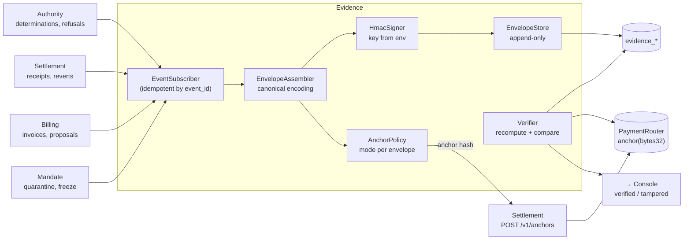
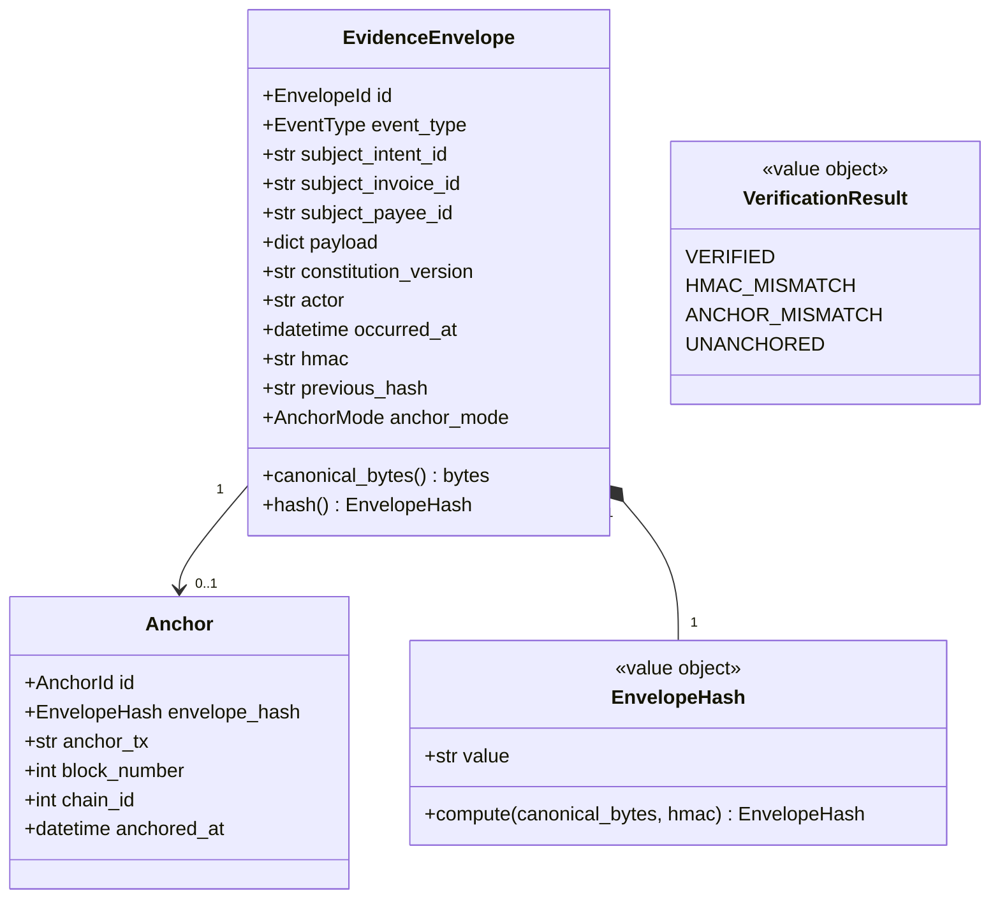
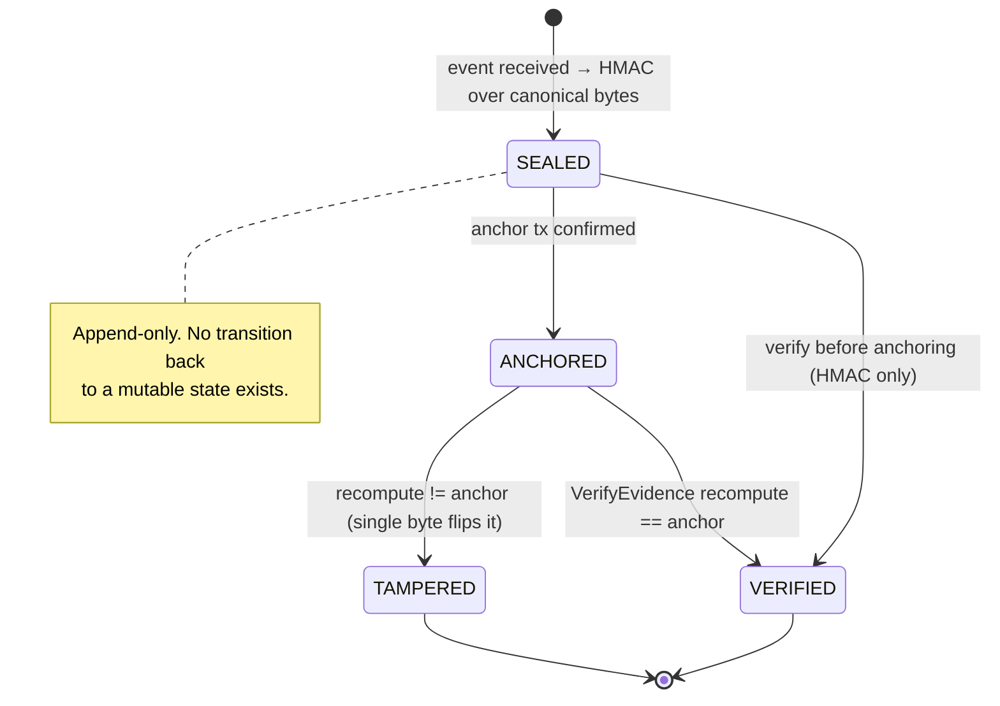
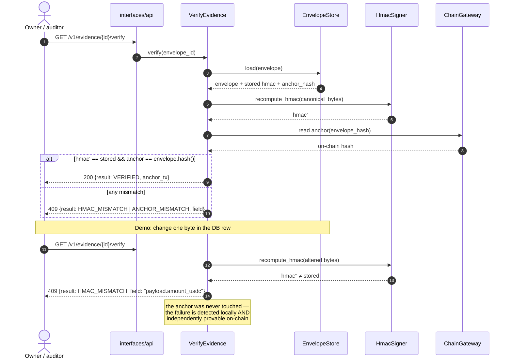

# Evidence

## Module Status

**Status:** Planned
**Depends:** Authority (determinations/refusals), Settlement (receipts/reverts + anchor), Billing (invoice/proposal events), Mandate (payee status events)
**Used by:** Console
**Last reviewed:** 2026-11-13
**Source session:** 432050ea-0419-44ba-8ac4-b239242634b4

## Description

Capture-and-verify context: appends a signed HMAC envelope for every attempt, determination,
refusal, approval, settlement and revert, and anchors envelope hashes on-chain. It consumes
events from Authority, Settlement and Billing and publishes verification for the console and
auditors.

It holds **no enforcement power** — it is a witness, not a guard. If Evidence is down,
payments still move (and the gap is visible, envellopped as a missing-witness warning).

**Modeling Depth:** service (supporting subdomain)
**Subdomain Rationale:** Crucial for trust and demo, but it is capture-and-verify plumbing over the other contexts' events.
**Context Map:** Evidence → Authority (open-host) (Authority publishes determinations and refusals; Evidence consumes and seals them.); Console → open-host (Evidence exposes verification endpoints the console renders for the owner and payer.); Settlement → partnership (Settlement publishes receipts and reverts for enveloping and asks Evidence to anchor the hash; anchoring is the shared on-chain write both contexts name 'anchor'.)

## Architecture

| Layer | Responsibility |
|-------|--------------|
| **Domain** | `EvidenceEnvelope`, `Anchor`, `EnvelopeHash`, `VerificationResult` (as captured) | `src/evidence/domain/` |
| **Application** | `SealEvidence`, `VerifyEvidence` | `src/evidence/application/` |
| **Infrastructure** | HMAC signer (key from operator env), envelope store (append-only), anchor client (Settlement), batching policy | `src/evidence/infrastructure/` |
| **Interfaces** | Event subscribers, verification REST handlers | `src/evidence/interfaces/` |

## Related ADRs

| ADR | Relevance |
|---|---|
| [ADR-002](../decisions/ADR-002-data-storage-strategy.md) | `evidence_*` tables are append-only; no UPDATE path exists in the repository API. |
| [ADR-003](../decisions/ADR-003-cross-context-communication.md) | This context is the canonical *subscriber*: every refusal event must be sealed, including on the failure path. |
| [ADR-005](../decisions/ADR-005-authentication-authorization.md) | The HMAC key is operator-held; it is never in the agent workspace or in an envelope payload. |
| [ADR-006](../decisions/ADR-006-cost-tracking-usage-metering.md) | Anchoring mode (`per_envelope | batched | demo_only`) is recorded on each envelope. |
| [ADR-007](../decisions/ADR-007-compliance-engine-architecture.md) | `anchor(bytes32)` on `PaymentRouter` is the on-chain half of tamper evidence. |

## Diagrams

### Data Flow



### Entity Relationship



### Aggregate State — Envelope



### Key Use Case Sequence — verify, then flip a byte (scenario 7)



## Components

### EvidenceEnvelope

```python
# src/evidence/domain/evidence_envelope.py
"""Canonical: .pi/architecture/modules/evidence.md#components"""


@dataclass(frozen=True)
class EvidenceEnvelope:
    id: EnvelopeId
    event_type: str
    subject_intent_id: str | None
    subject_invoice_id: str | None
    subject_payee_id: str | None
    payload: Mapping[str, Any]
    constitution_version: str | None
    actor: str
    occurred_at: datetime
    hmac: str
    previous_hash: str | None  # chain link: append-only, not a rewrite
    anchor_mode: str  # per_envelope | batched | demo_only

    def canonical_bytes(self) -> bytes:
        """Deterministic encoding — sorted keys, no floats, explicit nulls."""
        return json.dumps(
            {
                "event_type": self.event_type,
                "payload": self.payload,
                "subject": {
                    "intent": self.subject_intent_id,
                    "invoice": self.subject_invoice_id,
                    "payee": self.subject_payee_id,
                },
                "constitution_version": self.constitution_version,
                "actor": self.actor,
                "occurred_at": self.occurred_at.isoformat(),
                "previous_hash": self.previous_hash,
            },
            sort_keys=True,
            separators=(",", ":"),
        ).encode()

    def hash(self) -> EnvelopeHash:
        return EnvelopeHash.compute(self.canonical_bytes(), self.hmac)
```

**Invariants:** E-1 every attempt yields ≥1 envelope, **including refusals**; E-2 envelopes are
append-only (corrections are new envelopes referencing `previous_hash`); E-3 the HMAC key never
appears in an envelope or the agent workspace; E-4 a refusal is the same shape as a settlement —
not a lesser record.

### Value Objects

| VO | Justification | Not an entity because |
|---|---|---|
| `EnvelopeHash` | Deterministic hash over canonical bytes + HMAC; the value anchored on-chain. | Two equal hashes are the same proof. |
| `VerificationResult` | Closed set naming the failing field. | An enum; instances are interchangeable. |

Note the `Anchor` is an **entity** in the capture (`identityPersists`, one per envelope, with
its own tx and block) — kept as captured, not promoted further.

### Persistence contract

| Table | Key | Note |
|---|---|---|
| `evidence_envelopes` | `id` | append-only; `previous_hash` links the chain |
| `evidence_anchors` | `id` | `UNIQUE(envelope_hash)`; `anchor_tx`, `block_number`, `chain_id` |
| `evidence_processed_events` | `(event_id, handler)` | idempotency for at-least-once delivery |

### Ports

| Port | Adapter | Note |
|---|---|---|
| `AnchorGateway` | `SettlementAnchorAdapter` | Calls `POST /v1/anchors` (Settlement owns the chain write). |
| `EnvelopeSigner` | `HmacSigner` | Key from operator environment only. |
| `AnchorPolicy` | config-driven | `per_envelope` for the 7 demo scenarios, `batched` default (ADR-006). |

## Domain Events

| Event | Description | Trigger | Payload | Published By | Expert cares | Crosses boundary | Audit |
|---|---|---|---|---|---|---|---|
| `EnvelopeSealed` | A domain fact was wrapped, signed and appended. | SealEvidence | `envelope_id, event_type, subject ids, envelope_hash, anchor_mode` | Evidence | ✅ | ✅ | ✅ |
| `EnvelopeAnchored` | Envelope hash written on-chain, fixing integrity and time. | SealEvidence | `envelope_id, envelope_hash, anchor_tx, block_number, chain_id` | Evidence | ✅ | ✅ | ✅ |
| `EvidenceVerificationFailed` | Re-verification did not match the sealed envelope or its anchor. | VerifyEvidence | `envelope_id, result, failing_field` | Evidence | ✅ | ✅ | ✅ |

## Application Services

| Service | Use case | Maps to FR |
|---------|----------|-----------|
| `SealEvidence` | Wraps every attempt, determination, refusal, approval and settlement into a signed HMAC envelope and anchors its hash on-chain. | FR-022 |
| `VerifyEvidence` | Re-verifies an envelope for an auditor or the console and detects any single-byte tampering or anchor mismatch. | FR-023 |

Below the catalog: `ListEnvelopes`, `GetEnvelope`, `ReanchorBatch` (operational).

## API Endpoints

| Method | Path | Handler | Input | Output | Auth |
|---|---|---|---|---|---|
| GET | `/v1/evidence` | `interfaces/api.list_envelopes` | `?intent_id=&invoice_id=&event_type=&cursor=` | envelopes (no payload unless `?full=1`) | `evidence:read` |
| GET | `/v1/evidence/{id}` | `interfaces/api.get_envelope` | `?full=1` | envelope + hmac + anchor | `evidence:read` |
| GET | `/v1/evidence/{id}/verify` | `interfaces/api.verify` | — | `{result, field?, anchor_tx}` (409 on mismatch) | `console:read` |
| GET | `/v1/evidence/{id}/anchor` | `interfaces/api.get_anchor` | — | anchor tx, block, chain id | `evidence:read` |

## Ubiquitous Language

| Term | Definition |
|------|-----------|
| evidence envelope | Signed immutable wrapper around one domain fact, containing subject ids, the fact payload, the constitution version consulted and an HMAC. |
| envelope hash | Canonical hash of an envelope including its HMAC; what gets anchored on-chain and re-compared at verification. |
| anchor | The on-chain record of an envelope hash, giving independent integrity and time that the operator cannot rewrite. |
| refusal record | A first-class evidence artifact for a denied payment, carrying the reason code and the constitution version that produced it. |
| tamper evidence | HMAC proves no one in the operator domain edited the record; the anchor proves the record existed at a point in chain time. |

## Dependencies

### Depends On

| Module | What it provides |
|---|---|
| **Authority** | `AuthorityDetermined`, `PaymentAllowed`, `PaymentRefused`, `Approval*` — including refusals (open-host publisher). |
| **Settlement** | `SettlementConfirmed`, `SettlementReverted`, `DuplicateSettlementBlocked`, and the anchor write itself (partnership). |
| **Billing** | `InvoiceRecorded`, `PaymentProposed`, `ProposalRejected`. |
| **Mandate** | `PayeeQuarantined`, `PayeeFrozen`, `PayeeReapproved`. |

### Used By

| Consumer | What it needs |
|---|---|
| **Console** | Verification and envelope read models; the "verified / tampered" toggle (open-host). |

## Implementation Sequence

1. `EnvelopeHash` + canonical encoding (determinism test: same input → same bytes, keys sorted).
2. `EvidenceEnvelope` + `HmacSigner` (key from env; a test asserts the key is absent from output).
3. Append-only store + `previous_hash` linking; migration `004_evidence`.
4. `SealEvidence` subscribed to every event from ADR-003's delivery table, idempotent by
   `(event_id, handler)`.
5. `AnchorGateway` → Settlement; `AnchorPolicy` with `per_envelope` for demo scenarios.
6. `VerifyEvidence` with the three failure results, including the one-flipped-byte test.
7. Console-facing verification endpoint (this is the scenario-7 demo surface).

## Patterns & OOP Mapping

| Component | Pattern | Rationale |
|---|---|---|
| `EvidenceEnvelope` | **Immutable record + canonical serialization** | Verification is only meaningful if the bytes are reproducible. |
| `EnvelopeSigner` | **Strategy (HMAC now, KMS later)** | Two plausible implementations justify the port even at 24h — the OSS verifier needs the same interface. |
| `AnchorPolicy` | **Strategy** | Three real modes (`per_envelope`, `batched`, `demo_only`) with different costs. |
| `EventSubscriber` | **Observer (idempotent)** | At-least-once delivery requires a dedupe key, not a new pattern. |
| `previous_hash` chain | **Hash chain** | Gives ordering proof without a separate ledger. |

## Acceptance Criteria

| # | Component | Criterion | Verify In |
|---|---|---|---|
| 1 | Canonical bytes | Same envelope content → byte-identical output across runs and key orderings. | unit |
| 2 | HMAC sealing | Every event in ADR-003's table produces exactly one envelope with a valid HMAC. | integration |
| 3 | Refusal sealed | A denied payment produces an envelope whose `event_type` is `PaymentRefused` and whose payload carries the reason codes. (scenario 2/3/4) | integration |
| 4 | Idempotency | The same `event_id` delivered 3× produces 1 envelope. | integration |
| 5 | Append-only | Repository exposes no update/delete; a direct UPDATE is rejected by a CHECK/trigger or asserted absent. | integration |
| 6 | Verify OK | Untouched envelope → `VERIFIED` with the anchor tx. (scenario 7) | integration |
| 7 | One flipped byte | Altering one byte of `payload` → `HMAC_MISMATCH` naming the field; anchor unchanged. (scenario 7) | integration |
| 8 | Anchor mismatch | Pointing an envelope at a different anchor hash → `ANCHOR_MISMATCH`. | integration |
| 9 | Key isolation | No envelope payload, log line or DB column contains the HMAC key; a grep test enforces it. | automated |
| 10 | Witness-only | Stopping Evidence does not block dispatch; the missing witness is detectable afterwards. | integration |
| 11 | Layer purity | `src/evidence/domain/` imports no FastAPI/SQLAlchemy/web3. | automated |

## Modeling Depth Note (ADR-008)

This bounded context is a **supporting subdomain** — model at service/CRUD depth.
Keep implementation to application services + persistence. Do NOT introduce new
aggregates, value objects, or domain events beyond what this exploration captured.

**Anti-corruption edges:**
- Evidence open-host Authority — Authority publishes determinations and refusals; Evidence consumes and seals them.
- Settlement partnership Evidence — Settlement publishes receipts and reverts for enveloping and asks Evidence to anchor the hash.
- Console open-host Evidence — Evidence exposes verification endpoints the console renders.

Concretely: the four captured types are kept (one aggregate root, one entity, two value
objects) and the three captured events; no new domain concepts were invented at enrichment.

## Open Questions

- Does Evidence own the HMAC key lifecycle, or receive it from operator config at boot? Modelled
  as: operator config at boot, never persisted by Evidence. Needs confirmation.
- Batching weakens per-event time proofs — is a labated `batch_id` sufficient for the judges, or
  should all demo envelopes be anchored individually? Current default: individually for the 7
  scenarios.

---

**Canonical:** `.pi/architecture/modules/evidence.md`
**Last updated:** 2026-11-13