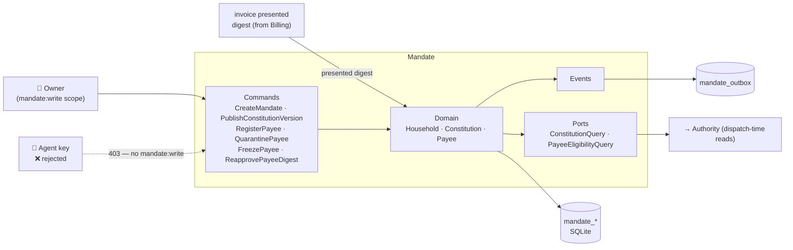
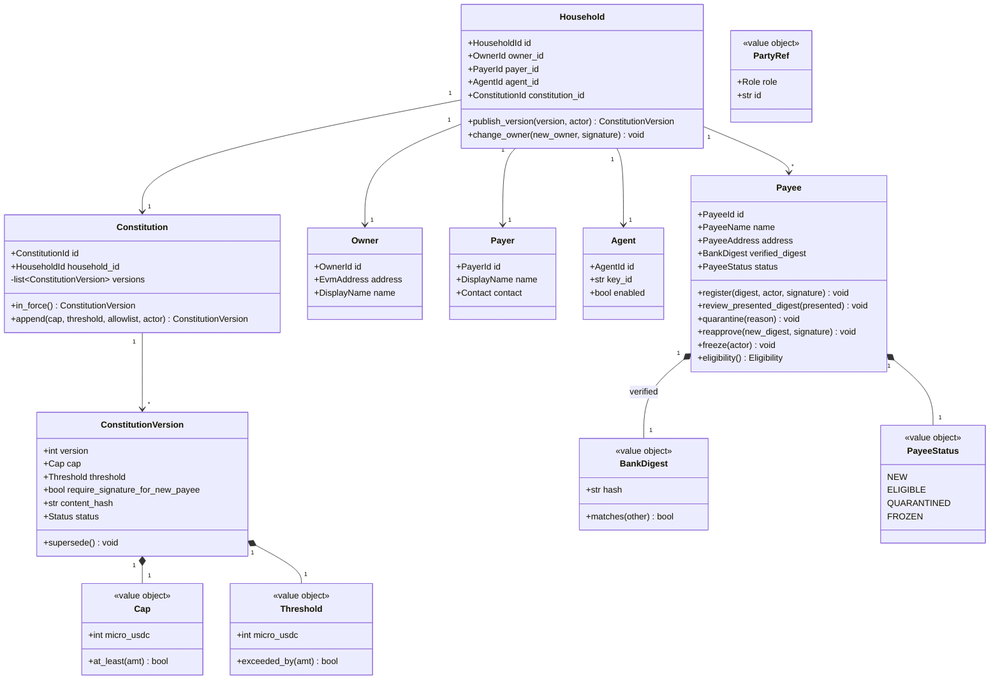
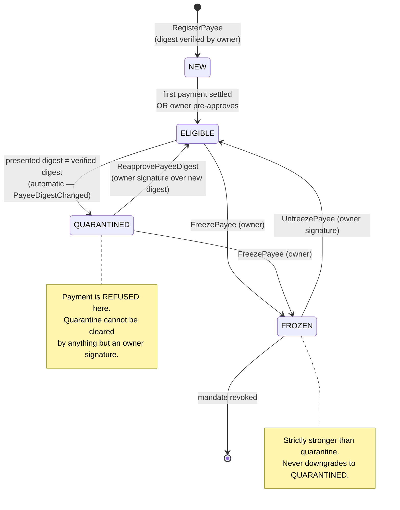
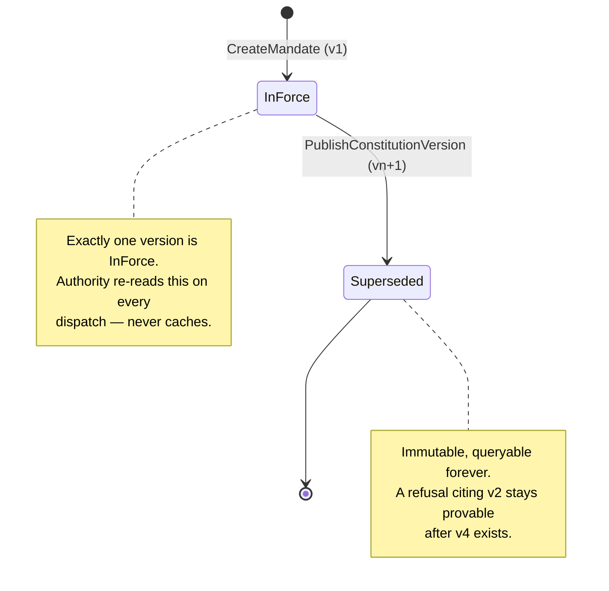
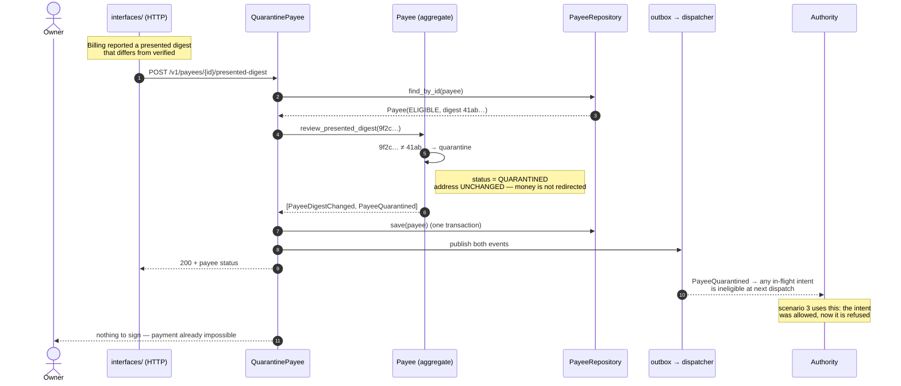

# Mandate

## Module Status

**Status:** Implemented (Phase 1 complete)
**Depends:** *(none — pure upstream)*
**Used by:** Authority, Billing, Settlement, Console
**Last reviewed:** 2026-11-13
**Source session:** 432050ea-0419-44ba-8ac4-b239242634b4

## Description

Owns the household, its parties (owner, payer, agent), the payee registry with verified bank
digests, and the immutable constitution versions that define caps, thresholds and approval
rules. It is the single source of truth for **what is allowed**; it never decides a specific
payment. Mandate answers "who may be paid, up to how much, under which rules" — Authority asks,
at the moment of consequence.

**Modeling Depth:** tactical (core domain)
**Subdomain Rationale:** The differentiator is delegated-but-bounded authority; the rules of who may be paid and how much are the product.
**Context Map:** Authority → conformist (Authority reads the in-force constitution version and live payee eligibility at dispatch time; re-read, never cached, per 'authority re-read at moment of consequence'.); Settlement → conformist (Settlement uses the payee address carried on the PaymentIntent, which originates from Mandate's verified bank digest — never from invoice text.); Billing → conformist (Invoices reference a Mandate-issued payee id and present a bank digest for comparison; invoice text is never authoritative for routing.); Console → open-host (Console reads constitution and payee status for display only; it may request a version but the owner signature is what publishes it.)

## Architecture

This module follows **Domain-Driven Design** with Clean Architecture layers:

| Layer | Responsibility |
|-------|--------------|
| **Domain** | Aggregates, entities, value objects, domain services, repository interfaces | `src/mandate/domain/` |
| **Application** | Use cases / application services, DTOs, input validation | `src/mandate/application/` |
| **Infrastructure** | Repository implementations, DB models, external clients | `src/mandate/infrastructure/` |
| **Interfaces** | API handlers, event subscribers, serialization | `src/mandate/interfaces/` |

Dependency rule: `domain/` imports only the shared kernel (`src/shared/`). No FastAPI, no
SQLAlchemy, no requests. The layer is verified by a contract test (`dip-domain` gate).

## Related ADRs

| ADR | Relevance to this module |
|---|---|
| [ADR-001](../decisions/ADR-001-architecture-pattern.md) | Mandate is a pure upstream in the modular monolith; nothing may import *into* it except its own layers. |
| [ADR-002](../decisions/ADR-002-data-storage-strategy.md) | `mandate_*` tables, SQLAlchemy infrastructure, ORM never in `domain/`. |
| [ADR-003](../decisions/ADR-003-cross-context-communication.md) | `PayeeQuarantined` / `PayeeFrozen` / `ConstitutionVersionPublished` are the invalidations Authority must react to. |
| [ADR-005](../decisions/ADR-005-authentication-authorization.md) | Only the owner scope may publish a version, freeze a payee or re-approve a digest; the agent key provably cannot. |
| [ADR-007](../decisions/ADR-007-compliance-engine-architecture.md) | This module's constitution is the data the enforcement engine reads at Lock 2. |

## Diagrams

### Data Flow



### Entity Relationship



### Aggregate State — Payee (the consequential one)



### Aggregate State — Constitution



### Key Use Case Sequence — poisoned invoice (scenario 2)



## Components

### Aggregate: Household

The single tenancy root. Guards that exactly one constitution version is in force.

```python
# src/mandate/domain/household.py
"""Canonical: .pi/architecture/modules/mandate.md#aggregate-household
Reference: .pi/architecture/decisions/ADR-001-architecture-pattern.md"""

from dataclasses import dataclass, field

from src.shared.domain.aggregate import AggregateRoot
from src.mandate.domain.events import OwnerRegistered, PayerEnrolled, AgentAuthorised
from src.mandate.domain.values import EvmAddress, DisplayName, PartyRef, Role


@dataclass
class Household(AggregateRoot):
    """One owner, one payer, one agent, one constitution lineage."""

    id: HouseholdId
    owner: Owner
    payer: Payer
    agent: Agent
    constitution_id: ConstitutionId

    @classmethod
    def open(
        cls, owner: Owner, payer: Payer, agent: Agent, constitution: Constitution
    ) -> "Household":
        """Factory: the only legal way to create a household (3 parties + v1)."""
        household = cls(
            id=HouseholdId.new(),
            owner=owner,
            payer=payer,
            agent=agent,
            constitution_id=constitution.id,
        )
        household.record(OwnerRegistered(owner_id=owner.id, address=owner.address))
        household.record(PayerEnrolled(payer_id=payer.id))
        household.record(AgentAuthorised(agent_id=agent.id))
        return household

    def change_owner(self, new_owner: Owner, proof: OwnerSignatureProof) -> None:
        """Owner rotation requires the outgoing owner's signature — not a key."""
        if not proof.signs(self.id, new_owner.address):
            raise OwnerProofInvalid()
        self.owner = new_owner
        self.record(OwnerRegistered(owner_id=new_owner.id, address=new_owner.address))

    def assert_owner_acts(self, actor: PartyRef) -> None:
        if actor.role is not Role.OWNER:
            raise OwnerActionRequired(actor.role)
```

**Invariants (aggregate-local):**
| # | Rule | Prevents |
|---|---|---|
| H-1 | A household has exactly one owner, one payer and one agent. | Two parties both claiming to authorize, or an unowned household. |
| H-2 | The payer never holds a signing capability and the agent never holds a key. | Custody drifting to a party who cannot be held accountable. |
| H-3 | Only `PartyRef(role=OWNER)` may mutate the household; agent actors raise `OwnerActionRequired`. | Agent or stolen operator key editing policy to widen its own authority. |

### Aggregate: Constitution

Append-only lineage. Publishing supersedes; it never mutates.

```python
# src/mandate/domain/constitution.py
"""Canonical: .pi/architecture/modules/mandate.md#aggregate-constitution"""

from dataclasses import dataclass, field


@dataclass
class Constitution(AggregateRoot):
    id: ConstitutionId
    household_id: HouseholdId
    _versions: list[ConstitutionVersion] = field(default_factory=list)

    @property
    def in_force(self) -> ConstitutionVersion:
        live = [v for v in self._versions if v.status is VersionStatus.IN_FORCE]
        if len(live) != 1:
            raise ConstitutionCorrupted(len(live))  # H-4
        return live[0]

    def append(
        self,
        cap: Cap,
        threshold: Threshold,
        require_signature_for_new_payee: bool,
        actor: PartyRef,
        proof: OwnerSignatureProof,
    ) -> ConstitutionVersion:
        self.assert_owner_acts(actor)
        if not proof.signs(self.household_id, cap, threshold):  # H-5
            raise OwnerProofInvalid()
        if threshold.micro_usdc > cap.micro_usdc:  # H-6
            raise ThresholdExceedsCap(threshold, cap)

        previous = self.in_force
        next_version = previous.next_version(cap, threshold, require_signature_for_new_payee)

        previous.supersede()  # immutable afterwards — no setters exist
        self._versions.append(next_version)
        self.record(
            ConstitutionVersionPublished(
                version=next_version.version, content_hash=next_version.content_hash
            )
        )
        if cap != previous.cap:
            self.record(CapChanged(from_=previous.cap, to=cap))
        if threshold != previous.threshold:
            self.record(ThresholdChanged(from_=previous.threshold, to=threshold))
        return next_version

    def version(self, number: int) -> ConstitutionVersion:
        """Historical lookup — a refusal must stay explainable after supersession."""
        return next(v for v in self._versions if v.version == number)
```

**Invariants (aggregate-local):**
| # | Rule | Prevents |
|---|---|---|
| H-4 | Exactly one constitution version is `IN_FORCE` per household. | Two contradictory rule sets both claiming to authorize a payment. |
| H-5 | Appending a version requires an owner signature over the new cap/threshold. | The agent (or a stolen key) loosening its own limits. |
| H-6 | `threshold.micro_usdc <= cap.micro_usdc`, and both are positive. | A threshold above the cap that makes the cap meaningless, or a zero cap that silently blocks everything. |
| H-7 | A published version is immutable; no setter exists and `status` may move only `IN_FORCE → SUPERSEDED`. | Retroactively loosening rules to make an already-refused payment look allowed. |
| H-8 | Version numbers are contiguous from 1 and `content_hash` matches content. | A version inserted or edited after the fact. |

### Aggregate: Payee

The eligibility gate. This aggregate is where the bank-detail-change scam dies.

```python
# src/mandate/domain/payee.py
"""Canonical: .pi/architecture/modules/mandate.md#aggregate-payee"""

from dataclasses import dataclass


@dataclass
class Payee(AggregateRoot):
    id: PayeeId
    household_id: HouseholdId
    name: PayeeName
    address: PayeeAddress  # verified payout address — never from invoice text
    verified_digest: BankDigest  # owner-approved baseline
    status: PayeeStatus

    @classmethod
    def register(cls, name, address, digest, actor: PartyRef, proof) -> "Payee":
        if actor.role is not Role.OWNER:
            raise OwnerActionRequired(actor.role)  # P-1
        if not proof.signs(digest, address):
            raise OwnerProofInvalid()
        payee = cls(PayeeId.new(), actor.household_id, name, address, digest, PayeeStatus.NEW)
        payee.record(PayeeRegistered(payee_id=payee.id, digest=digest, address=address))
        return payee

    def review_presented_digest(self, presented: BankDigest) -> None:
        """Called when an invoice arrives. Mismatch quarantines; it never rebinds."""
        if self.status is PayeeStatus.FROZEN:
            return  # P-4 freeze dominates
        if presented.matches(self.verified_digest):
            return
        self.status = PayeeStatus.QUARANTINED  # P-2
        self.record(
            PayeeDigestChanged(payee_id=self.id, presented=presented, verified=self.verified_digest)
        )
        self.record(PayeeQuarantined(payee_id=self.id, reason="bank_digest_mismatch"))
        # NOTE: self.address is deliberately NOT updated.

    def reapprove(self, new_digest: BankDigest, actor: PartyRef, proof) -> None:
        if actor.role is not Role.OWNER:  # P-3
            raise OwnerActionRequired(actor.role)
        if not proof.signs(self.id, new_digest):
            raise OwnerProofInvalid()
        self.verified_digest = new_digest  # P-5 only path to change
        self.status = PayeeStatus.ELIGIBLE
        self.record(PayeeReapproved(payee_id=self.id, digest=new_digest))

    def freeze(self, actor: PartyRef) -> None:
        if actor.role is not Role.OWNER:
            raise OwnerActionRequired(actor.role)
        self.status = PayeeStatus.FROZEN  # P-4 stronger than quarantine
        self.record(PayeeFrozen(payee_id=self.id))

    def eligibility(self) -> Eligibility:
        """Derived, read-only. Authority consumes exactly this."""
        return {
            PayeeStatus.NEW: Eligibility.escalate("new_payee"),
            PayeeStatus.ELIGIBLE: Eligibility.allow(),
            PayeeStatus.QUARANTINED: Eligibility.deny("payee_quarantined"),
            PayeeStatus.FROZEN: Eligibility.deny("payee_frozen"),
        }[self.status]
```

**Invariants (aggregate-local):**
| # | Rule | Prevents |
|---|---|---|
| P-1 | Only the owner may register a payee, and only with a verified address + digest; it starts `NEW`. | First payment to an unverified address passing as a normal auto-pay. |
| P-2 | A presented digest differing from `verified_digest` sets `QUARANTINED` and **never** rewrites `address`. | A scam invoice silently rebinding a payee to an attacker address. |
| P-3 | Only an owner signature may clear `QUARANTINED`. | The agent talking its way back to eligible. |
| P-4 | `FROZEN` is absorbing relative to quarantine: it never downgrades, and digest review is a no-op. | A freeze being softened by an automatic transition back to payable. |
| P-5 | `verified_digest` changes only through `reapprove()`. | Any silent baseline drift. |
| P-6 | `eligibility()` is derived from status, never settable. | A caller asserting eligibility independent of status. |

### Value Objects (with entity-vs-VO justification)

| VO | Justification | Not an entity because |
|---|---|---|
| `BankDigest` | Deterministic hash over routing details; equality by hash is the entire meaning. | Two equal digests *are* the same destination — there is no identity to track. |
| `Cap` | Daily ceiling; defined entirely by its amount. | A "cap #7" distinct from a cap of 150 USDC is meaningless. |
| `Threshold` | Auto-pay limit; defined by its amount, valid only relative to a `Cap`. | Same — no lifecycle, no identity. |
| `PayeeStatus` | Closed set of four states with defined transitions. | An enum with rules; instances are interchangeable. |
| `PartyRef` | `(role, id)` pair used to attribute an action in an event. | Carries no state of its own; two equal refs are indistinguishable. |

Value objects are `frozen=True` dataclasses with validation in `__post_init__` — an invalid
`Cap(-5)` is unconstructible, so no downstream check needs to trust it.

### Repository interfaces (owned by `domain/`)

```python
# src/mandate/domain/repositories.py
"""Canonical: .pi/architecture/modules/mandate.md#components
Reference: .pi/architecture/decisions/ADR-002-data-storage-strategy.md"""

from abc import ABC, abstractmethod


class HouseholdRepository(ABC):
    @abstractmethod
    async def find_by_id(self, id_: HouseholdId) -> Household | None: ...
    @abstractmethod
    async def save(self, household: Household) -> None: ...


class ConstitutionRepository(ABC):
    @abstractmethod
    async def find_by_id(self, id_: ConstitutionId) -> Constitution | None: ...
    @abstractmethod
    async def find_in_force(self, household_id: HouseholdId) -> ConstitutionVersion: ...
    @abstractmethod
    async def save(self, constitution: Constitution) -> None: ...


class PayeeRepository(ABC):
    @abstractmethod
    async def find_by_id(self, id_: PayeeId) -> Payee | None: ...
    @abstractmethod
    async def find_by_household(self, household_id: HouseholdId) -> list[Payee]: ...
    @abstractmethod
    async def save(self, payee: Payee) -> None: ...
```

The implementations live in `src/mandate/infrastructure/repositories.py` (SQLAlchemy +
row→aggregate mappers). `domain/` knows nothing about SQLite.

### Domain Services

| Service | Why it is not on an aggregate |
|---|---|
| `EligibilityResolver` | Combines constitution `require_signature_for_new_payee` with payee status; spans two aggregates, so it is a stateless domain service in `domain/services.py`. |

## Domain Events

| Event | Description | Trigger | Payload | Published By | Expert cares | Crosses boundary | Audit |
|---|---|---|---|---|---|---|---|
| `MandateCreated` | Household mandate exists with owner, payer, agent and v1. | CreateMandate | `household_id, owner_id, payer_id, agent_id, constitution_version` | Mandate | ✅ | ✅ | ✅ |
| `OwnerRegistered` | Owner address is the sole signature authority. | CreateMandate, ChangeOwner | `household_id, owner_id, address` | Mandate | ✅ | ✅ | ✅ |
| `PayerEnrolled` | Parent enrolled as beneficiary; no signing capability. | CreateMandate | `household_id, payer_id` | Mandate | ✅ | ❌ | ✅ |
| `AgentAuthorised` | Software identity granted proposal-only authority. | CreateMandate | `household_id, agent_id, constitution_version` | Mandate | ✅ | ✅ | ✅ |
| `ConstitutionVersionPublished` | New immutable rule set is in force; previous superseded. | PublishConstitutionVersion | `constitution_id, version, content_hash, cap, threshold, published_at` | Mandate | ✅ | ✅ | ✅ |
| `CapChanged` | Daily ceiling changed. | PublishConstitutionVersion | `household_id, version, from_cap, to_cap` | Mandate | ✅ | ✅ | ✅ |
| `ThresholdChanged` | Auto-pay limit changed. | PublishConstitutionVersion | `household_id, version, from_threshold, to_threshold` | Mandate | ✅ | ✅ | ✅ |
| `PayeeRegistered` | Payee entered allowlist as `NEW` with verified digest. | RegisterPayee | `payee_id, name, address, digest` | Mandate | ✅ | ✅ | ✅ |
| `PayeeDigestChanged` | Invoice presented routing details unlike the verified digest. | QuarantinePayee | `payee_id, presented_digest, verified_digest, invoice_id` | Mandate | ✅ | ✅ | ✅ |
| `PayeeQuarantined` | Payee ineligible until owner re-approves. | QuarantinePayee | `payee_id, reason, at` | Mandate | ✅ | ✅ | ✅ |
| `PayeeFrozen` | Owner suspended the payee entirely. | FreezePayee | `payee_id, actor, at` | Mandate | ✅ | ✅ | ✅ |
| `PayeeReapproved` | Owner accepted new digest; baseline replaced, payee eligible. | ReapprovePayeeDigest | `payee_id, previous_digest, new_digest, actor` | Mandate | ✅ | ✅ | ✅ |

Subscribers: Authority (all of them — it must invalidate any plan-time view), Evidence (seal),
Console (read model). Refusals are not Mandate's business; Mandate only makes things impossible.

## Application Services

| Service | Use case | Maps to FR |
|---------|----------|-----------|
| `CreateMandate` | Owner establishes the household mandate: registers owner address, payer, agent identity and the first constitution version. | FR-001 |
| `PublishConstitutionVersion` | Owner appends a new immutable constitution version with caps, thresholds and approval rules; the previous version is superseded but retained. | FR-002 |
| `RegisterPayee` | Owner registers a payee with a verified payout address and bank digest, establishing the trusted routing baseline. | FR-004 |
| `QuarantinePayee` | Reacts to a bank-digest mismatch by suspending the payee until the owner re-approves the new routing details. | FR-005 |
| `FreezePayee` | Owner freezes a payee so it becomes ineligible at the next dispatch even if it was eligible when the payment was planned. | FR-006 |
| `ReapprovePayeeDigest` | Owner signs off on the new bank details; the verified digest baseline is replaced and the payee returns to eligible. | FR-005 |

Below the catalog (supporting endpoints only, no new domain logic): `ChangeOwner`,
`UnfreezePayee`, `GetConstitution`, `ListPayees`.

Transaction placement: one application service = one unit of work = one transaction. Events are
written to `mandate_outbox` in that same transaction (ADR-003).

## API Endpoints

| Method | Path | Handler | Input | Output | Auth |
|---|---|---|---|---|---|
| POST | `/v1/households` | `interfaces/api.create_household` | owner addr, payer, agent key id, cap, threshold | household + v1 | `mandate:write` (owner) |
| POST | `/v1/households/{id}/owner` | `interfaces/api.change_owner` | new owner addr, signature | owner | `mandate:write` + signature |
| GET | `/v1/households/{id}/constitution` | `interfaces/api.get_constitution` | `?version=` optional | version (in force by default) | `mandate:read` |
| POST | `/v1/households/{id}/constitution/versions` | `interfaces/api.publish_version` | cap, threshold, flags, signature | new version | `mandate:write` + signature |
| GET | `/v1/households/{id}/payees` | `interfaces/api.list_payees` | — | payees + status | `mandate:read` |
| POST | `/v1/households/{id}/payees` | `interfaces/api.register_payee` | name, address, routing details, signature | payee (NEW) | `mandate:write` + signature |
| POST | `/v1/payees/{id}/presented-digest` | `interfaces/api.review_digest` | presented digest, invoice_id | payee status | `billing:propose` (internal) |
| POST | `/v1/payees/{id}/reapprove` | `interfaces/api.reapprove` | new routing details, signature | payee (ELIGIBLE) | `mandate:write` + signature |
| POST | `/v1/payees/{id}/freeze` | `interfaces/api.freeze` | — | payee (FROZEN) | `mandate:write` (owner) |
| POST | `/v1/payees/{id}/unfreeze` | `interfaces/api.unfreeze` | signature | payee | `mandate:write` + signature |
| GET | `/v1/payees/{id}/eligibility` | `interfaces/api.eligibility` | — | `{allow\|escalate\|deny, reason}` | `authority:evaluate` |

Internal contract used by Authority at Lock 2:
`GET /v1/households/{id}/constitution?in_force=true` and `GET /v1/payees/{id}/eligibility`
must be **read-through** (no cache, no fallback to a previous response) — this is the
"moment of consequence" rule expressed as an endpoint contract.

## Ubiquitous Language

| Term | Definition |
|------|-----------|
| owner | The adult child who funds the account and authors the constitution. The only party who can change rules, add payees or approve exceptions. |
| payer | The parent whose bills are being paid. Receives the service, holds no keys, signs nothing. |
| agent | Software identity that may only propose payments. Holds no keys and cannot edit policy or command paths. |
| mandate | The scoped, revocable grant of authority from owner to agent, pinned to one constitution version lineage and one household. |
| constitution | The operator-owned rule set the enforcement layer checks: caps, thresholds, allowlist, signature requirements. Immutable per version, append-only lineage. |
| payee | A registered biller with a verified payout address, a verified bank digest and an eligibility status. |
| bank digest | Hash over payee routing details. Replaces raw account numbers in every downstream check; a mismatch is the bank-detail-change scam signal. |
| quarantine | Payee-level suspension triggered automatically by a bank-digest mismatch; cleared only by an owner re-approval. |
| freeze | Owner-initiated payee suspension. Strictly stronger than quarantine and never automatic. |
| cap | The maximum total USDC that may be committed plus reserved within a rolling day, summed across all payees. |
| threshold | The per-payment amount above which an owner signature is mandatory, regardless of payee status. |
| party | One of the three roles in the mandate — owner, payer or agent — each with a fixed capability set. Roles never overlap for the MVP. |
| in force | The single constitution version currently binding on every determination. Authority must re-read it at dispatch, never cache. |
| superseded | State of a constitution version that has been replaced. It stays queryable so past determinations can be explained against the rules they actually used. |
| eligibility | The derived judgement of whether a payee may be paid right now: eligible, new (escalate), quarantined (refuse) or frozen (refuse). |
| verified digest | The bank digest the owner personally approved for a payee. Distinct from the digest an invoice presents, and the only one Settlement may route to. |
| re-approval | The owner-signed act of accepting a new bank digest for a payee and lifting quarantine. |

## Dependencies

### Depends On

- *(none)* — Mandate is the pure upstream. It must never import from another context.

### Used By

| Consumer | What it needs |
|---|---|
| **Authority** | `ConstitutionVersion` in force (cap, threshold, flags) and `eligibility()` per payee, **re-read at dispatch** (conformist). |
| **Billing** | Payee id + verified digest baseline to compare against a presented digest (conformist); invoice routing is never authoritative. |
| **Settlement** | Payee address as carried on the PaymentIntent (which originated here) — never re-read from invoice text (conformist). |
| **Console** | Read models: constitution version, payee list + status (open-host). |

## Implementation Sequence

1. Shared kernel: `AggregateRoot`, `ValueObject`, `DomainEvent`, `OwnerSignatureProof`, errors.
2. `BankDigest` + `Cap` + `Threshold` + `PayeeStatus` + validation tests (no I/O, fast).
3. `Payee` aggregate with all six invariants P-1…P-6 and its state machine tests.
4. `Constitution` + `ConstitutionVersion` with H-4…H-8.
5. `Household` + `Owner`/`Payer`/`Agent` with H-1…H-3.
6. Repository interfaces in `domain/`, SQLAlchemy implementations + migrations `001_mandate`.
7. Application services (catalog order) each with one transaction.
8. Interfaces/HTTP + scopes from ADR-005; authorization matrix test.
9. Wire `PayeeQuarantined`/`PayeeFrozen` into Authority's dispatch-time read (scenarios 2, 3).

## Patterns & OOP Mapping

| Component | Pattern | Rationale |
|---|---|---|
| `Household.open` | **Factory method** | Creating a household requires three parties *and* a constitution v1; a constructor would allow illegal halves. |

> **Amendment 2026-11-14 — `Household.open(..., household_id: HouseholdId | None = None)`.**
> The id must exist *before* the constitution and the owner's `PartyRef` are constructed, or the
> constitution is bound to an id the household does not have and every read-through by household
> finds no in-force version. The parameter is optional with a fresh id as the default, so existing
> call sites are unchanged. Frozen-signature test: `test_open_requires_all_three_parties_and_the_constitution`.
| `Constitution.append` | **Immutable snapshot lineage** | Versions are frozen dataclasses; supersession is a state flip, never an edit. |
| `Payee.eligibility` | **Strategy-by-lookup** | Four statuses map to three verdicts; the mapping is data, so it needs no class hierarchy yet (curriculum rule: no speculative abstraction). |
| `EligibilityResolver` | **Domain service** | Combines two aggregates (constitution flag + payee status); belongs to neither. |
| `OwnerSignatureProof` | **Value object / capability** | Passing proof as an argument makes "who authorized this" un-forgeable at the type level. |
| All VOs | **Immutable value objects** (`frozen=True`) | `Cap(-5)` must be unconstructible, not merely rejected later. |

OOP discipline: no setters on aggregate roots (`Payee.status` is only reachable through
`review_presented_digest` / `reapprove` / `freeze`); tell-don't-ask (`payee.eligibility()`,
not `if payee.status == …` in callers); command methods return domain events, queries return
values (CQS). No anemic `PayeeService.setStatus`.

Deliberately **not** introduced: a `Rule` strategy hierarchy (no second variant exists), a
`Household` event-sourcing store (no requirement), an abstract `Party` base class (three roles
share nothing but a name).

## Frozen Contracts (v1) — 2026-11-13

The public surface below is **frozen**. Implementation items fill in stub bodies; changing a name, a
field or a signature on this page is a contract version bump (`__contract_version__` in
`src/mandate/__init__.py`), not a refactor.

### Value objects — `src/mandate/domain/values.py`

| Type | Fields (name: type) | Why a value object, not an entity |
|---|---|---|
| `BankDigest` | `hash: str` | Two equal digests *are* the same destination |
| `Cap` | `micro_usdc: int` | Defined entirely by its amount |
| `Threshold` | `micro_usdc: int` | Same — positional inside a `ConstitutionVersion` |
| `PartyRef` | `role: Role, id: str, household_id: str` | A reference to another object's identity |
| `Eligibility` | `verdict: EligibilityVerdict, reason: str or None` | Pure derived data, no lifecycle |
| `RoutingDetails` | `scheme: str, account_number: str, routing_number: str` | Ordered input to the digest |
| `EvmAddress` / `PayeeAddress` / `DisplayName` / `PayeeName` | `value: str` | Validated primitives |

Enumerations: `Role{owner,payer,agent}` · `PayeeStatus{new,eligible,quarantined,frozen}` ·
`EligibilityVerdict{allow,escalate,deny}` · `ReasonCode` (below) · `VersionStatus{in_force,superseded}`.

### Reason codes — domain vocabulary (lowercase) vs wire codes (uppercase)

`ReasonCode` is what gets sealed into evidence and translated by the console copy table; `ErrorCode`
is what the ADR-004 envelope carries. Both are needed, and a contract test asserts they stay aligned.

| `ReasonCode` | `ErrorCode` | Escalate or refuse |
|---|---|---|
| `new_payee` | *(none — not an error)* | escalate |
| `digest_mismatch` | `DIGEST_MISMATCH` | refuse |
| `payee_quarantined` | `PAYEE_QUARANTINED` | refuse |
| `payee_frozen` | `PAYEE_FROZEN` | refuse |
| `cap_exceeded` | `CAP_EXCEEDED` | refuse |
| `duplicate_invoice` | `DUPLICATE_INVOICE` | refuse |
| `approval_invalid` | `APPROVAL_INVALID` | refuse |
| `amount_mismatch` | `AMOUNT_MISMATCH` | refuse |
| `budget_exhausted` | `BUDGET_EXHAUSTED` | refuse |

### Aggregates — behaviour surface only (no setters anywhere)

| Aggregate | Factory | Operations | Invariants |
|---|---|---|---|
| `Household` | `open(*, owner, payer, agent, constitution, actor)` | `change_owner`, `assert_owner_acts` | H-1…H-3 |
| `Constitution` | `initial(household_id, cap, threshold)` | `append`, `in_force` (property), `find_version`, `versions` | H-4…H-8 |
| `Payee` | `register(*, household_id, name, address, digest, actor, proof)` | `review_presented_digest`, `reapprove`, `freeze`, `unfreeze`, `eligibility` | P-1…P-6 |

`Constitution.find_version` is **not** `version`: `AggregateRoot.version` is the optimistic-concurrency
counter (ADR-002), and a method of that name would shadow it.

### Ports — `src/mandate/domain/`

| Port | Kind | Operations |
|---|---|---|
| `HouseholdRepository` | ABC | `find_by_id`, `save` |
| `ConstitutionRepository` | ABC | `find_by_id`, `find_in_force`, `find_version`, `save` |
| `PayeeRepository` | ABC | `find_by_id`, `find_by_household`, `save` |
| `EligibilityResolver` | ABC (domain service) | `resolve(status, *, require_signature_for_new_payee)` |
| `OwnerSignatureProof` | `Protocol` | `signs(*subjects) -> bool` |

No repository exposes `commit`, `flush` or `begin`: the unit of work belongs to
`src/shared/application/unit_of_work.py` (`txn-placement` gate).

### Application contracts — `src/mandate/application/`

Services (exact names, from the exploration use-cases pass):
`CreateMandate` (FR-001) · `PublishConstitutionVersion` (FR-002) · `RegisterPayee` (FR-004) ·
`QuarantinePayee` (FR-005) · `ReapprovePayeeDigest` (FR-005) · `FreezePayee` (FR-006) ·
`EligibilityReader` (FR-012, supporting).

DTOs (frozen dataclasses; amounts in integer micro-USDC, digests as hex, **never** routing details):
`CreateMandateCommand/Result` · `PublishConstitutionVersionCommand/Result` ·
`RegisterPayeeCommand/Result` · `ReviewPresentedDigestCommand/Result` ·
`ReapprovePayeeDigestCommand/Result` · `FreezePayeeCommand/Result` ·
`ConstitutionVersionView` · `PayeeView` · `EligibilityView`.

### Corrections made during the freeze

Three defects the contract tests and gates caught *before* any implementation depended on them:

1. **`OwnerActionRequired` lost its `role` detail.** Multiple inheritance from `ForbiddenError` and
   `MandateError` made `ForbiddenError.__init__` chain into `MandateError.__init__`, nesting `details`
   one level deep. Fixed with a single `__init__` on `MandateError` plus `default_code` /
   `default_status`.
2. **`**details` could rewrite an error's wire code.** A `**kwargs` tail let `details={"code": …}`
   override `code`. Replaced with an explicit `details: Mapping[str, str] | None` parameter.
3. **`Constitution.version()` shadowed `AggregateRoot.version`.** Renamed to `find_version`, matching
   the repository port.

(1) and (2) were found by the contract tests; (3) by `mypy`. That is the freeze doing its job.

### Implementation status (2026-11-13)

All six catalog application services, the 7 HTTP endpoints and the persistence adapters are
implemented; the context is installed in `console-api` (`HOSTED_CONTEXTS` in `apps/console_api/app.py`).
Verification, all deterministic:

| Gate | Command |
|---|---|
| contract proofs (40 checks, fails if an invariant anchor is removed) | `.pi/scripts/ci/prove_mandate_contracts.sh` |
| behaviour + contract tests | `pytest tests/unit/mandate` |
| persistence + HTTP integration | `pytest tests/integration/mandate` |
| layer/model judgment | `.pi/scripts/check_model_judgment.sh` |
| runtime wiring | `.pi/scripts/check_composition_root.sh` |

### Test artefacts

`tests/unit/mandate/` holds 9 contract test files (~200 assertions) asserting **shape** — types,
signatures, immutability, abstractness, layer purity — rather than behaviour, so they stay green as
behaviour lands. The generated originals were uncollectable (hyphenated method names → `SyntaxError`)
and tautological (`assert False`); they were rewritten per `.pi/skills/tdd-practice.md`
("tests are living artifacts").

## Acceptance Criteria

| # | Component | Criterion | Verify In |
|---|---|---|---|
| 1 | `BankDigest` | Two digests from identical routing details are equal; a one-character change alters the hash. | unit |
| 2 | `Cap` / `Threshold` | `Cap(0)` and `Cap(-1)` raise; `Threshold > Cap` raises at constitution append. | unit |
| 3 | `Payee.review_presented_digest` | Mismatch sets `QUARANTINED`, emits `PayeeDigestChanged` + `PayeeQuarantined`, and leaves `address` **byte-identical**. (scenario 2) | unit |
| 4 | `Payee.reapprove` | Without an owner proof → `OwnerProofInvalid`, status unchanged; with proof → `ELIGIBLE` + `PayeeReapproved`. | unit |
| 5 | `Payee.freeze` | After freeze, `review_presented_digest` is a no-op and status stays `FROZEN` (P-4). (scenario 3) | unit |
| 6 | `Payee` state machine | All 4 statuses reachable only via the documented transitions; no other path compiles/passes. | unit |
| 7 | `Constitution.append` | Requires owner proof; supersedes exactly one version; old version still readable by number. | unit |
| 8 | `Constitution` in force | `in_force` raises `ConstitutionCorrupted` when 0 or 2 versions are live. | unit |
| 9 | Agent actor | Any agent-role `PartyRef` on `register_payee`/`freeze`/`append` → `OwnerActionRequired` + HTTP 403. | integration |
| 10 | Digest endpoint | `POST /v1/payees/{id}/presented-digest` returns 200 and no other state change. | integration |
| 11 | Eligibility read-through | Two consecutive `GET /v1/payees/{id}/eligibility` calls with a freeze in between return `allow` then `deny` (no caching). | integration |
| 12 | Events | Each command publishes exactly its documented events to `mandate_outbox` in the same transaction. | integration |
| 13 | Layer purity | `src/mandate/domain/` imports no FastAPI/SQLAlchemy/httpx (dip-domain gate). | automated |

## Modeling Depth Note (ADR-008)

This bounded context is a **core subdomain** — model at full tactical depth. Aggregates are
real consistency boundaries with the exploration invariants mapped above
(`rule` → `illegalStatePrevented`), behavior lives on the aggregates, repository interfaces are
owned by `domain/`, value objects carry entity-vs-VO justification, and domain events are
triaged. Application services orchestrate; they never contain rules.

## Open Questions

- `UnfreezePayee` is a supporting operation not in the exploration catalog; it exists because
  `FROZEN` would otherwise be terminal within one mandate. Needs a product decision.
- Whether `NEW → ELIGIBLE` happens automatically after the first settled payment or requires an
  owner action is unresolved; the demo uses automatic-after-settlement and says so.

---

**Canonical:** `.pi/architecture/modules/mandate.md`
**Last updated:** 2026-11-13