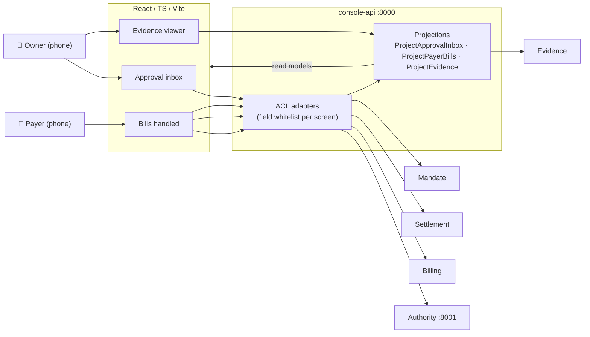
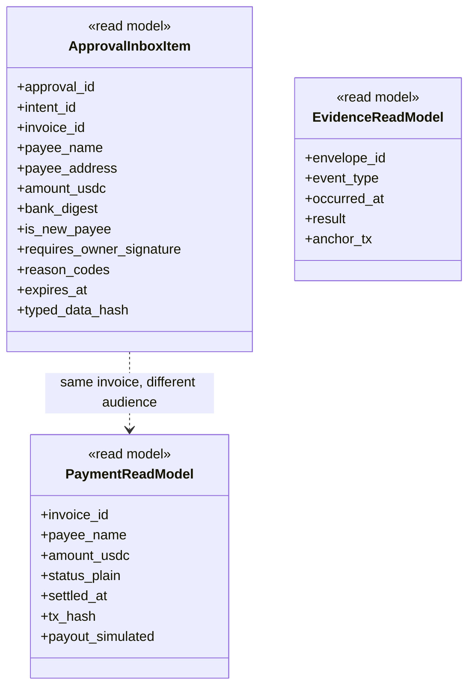
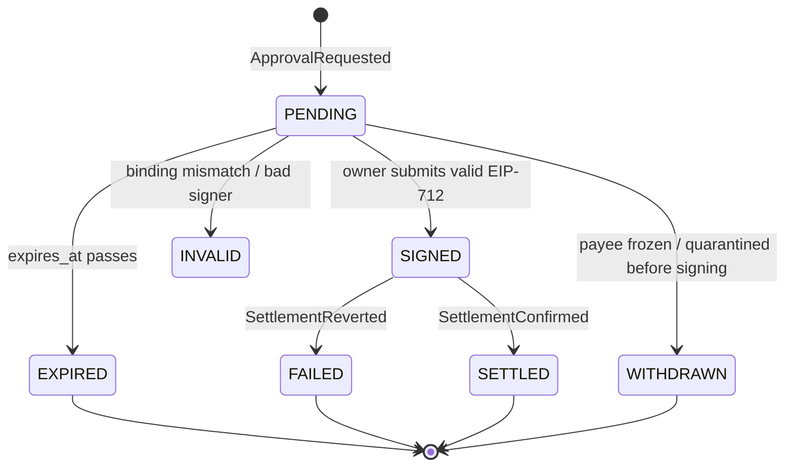
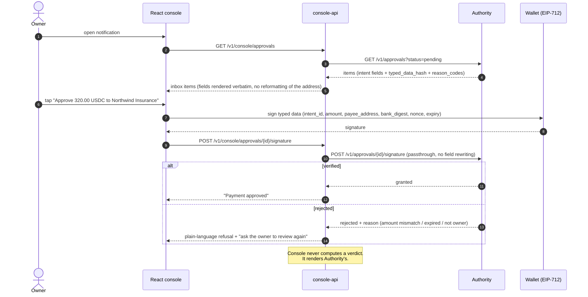

# Console

## Module Status

**Status:** Implemented
**Depends:** Authority (determinations, approvals), Evidence (verification), Mandate (constitution, payees), Billing (invoices), Settlement (receipts)
**Used by:** — (edge of the system)
**Last reviewed:** 2026-11-14
**Source session:** 432050ea-0419-44ba-8ac4-b239242634b4

## Description

API/UI composition and read models for owner and payer. **No business rules.** Console projects
other contexts' state into two human surfaces:

- **Owner surface** — approval inbox (sign the *exact* intent), payee status, constitution
  version, evidence viewer with a verified/tampered toggle.
- **Payer surface** — read-only "bills handled" list in household language, with the simulated
  bank payout explicitly labeled.

It cannot trigger a payment. The only consequential write it may perform is submitting an owner
signature — and that signature is bound to intent fields the console merely displays.

**Modeling Depth:** adapter (generic subdomain)
**Subdomain Rationale:** Pure presentation/composition; rules live elsewhere by principle 7.
**Context Map:** Console → Authority (anticorruption-layer) (Console consumes read models and submits approvals; it cannot trigger a payment directly.); Console → Evidence (open-host) (Evidence exposes verification endpoints the console renders for the owner and payer.); Console → Mandate (open-host) (Console reads constitution and payee status for display only; it may request a version but the owner signature is what publishes it.)

## Architecture

| Layer | Responsibility |
|-------|--------------|
| **Domain** | *(none — by design)* |
| **Application** | `ProjectApprovalInbox`, `ProjectPayerBills`, `ProjectEvidence` (projections only) | `src/console/application/` |
| **Infrastructure** | HTTP clients to Authority/Mandate/Evidence/Settlement; read-model cache (in-process, TTL) | `src/console/infrastructure/` |
| **Interfaces** | REST handlers for the React app | `src/console/interfaces/` |

There is no `src/console/domain/` package. Introducing one is an architecture violation, not a
refactor.

## Related ADRs

| ADR | Relevance |
|---|---|
| [ADR-001](../decisions/ADR-001-architecture-pattern.md) | Console is a generic context; it may depend on everything and nothing may depend on it. |
| [ADR-004](../decisions/ADR-004-api-design.md) | Console endpoints are the contract the React app is built against (OpenAPI by hour 6). |
| [ADR-005](../decisions/ADR-005-authentication-authorization.md) | Owner vs payer scopes; the console's only write is `POST /v1/approvals/{id}/signature`. |
| [ADR-003](../decisions/ADR-003-cross-context-communication.md) | Read models are fed by events for lists; single-record detail may call through. |
| [ADR-007](../decisions/ADR-007-compliance-engine-architecture.md) | The console must display *why* a payment was refused (Lock 2 reason codes). |

## Diagrams

### Data Flow



### Entity Relationship — projections only (no aggregates)



These are **DTOs**, not entities: no identity, no lifecycle, no invariants. Two identical
`PaymentReadModel` instances are interchangeable.

### Projection State — approval inbox item



### Key Use Case Sequence — owner approves on a phone



## Components

**No aggregates, entities or value objects.** Per ADR-008, a generic subdomain is modelled as an
interface plus an anti-corruption layer.

### Application services (catalog)

| Service | Use case | Maps to FR |
|---------|----------|-----------|
| `ProjectApprovalInbox` | Read-model projection for the owner of pending signature requests with exact intent details; carries no business rules. | FR-024 |
| `ProjectPayerBills` | Read-only projection for the payer of handled and settled bills in household language, with the simulated bank payout labeled. | FR-025 |

### Anti-corruption layer — field whitelists

Each screen gets an explicit whitelist so a new upstream field can never leak by accident:

```python
# src/console/infrastructure/acl.py
"""Canonical: docs/architecture/modules/console.md#components
Reference: docs/architecture/decisions/ADR-001-architecture-pattern.md"""

OWNER_INBOX_FIELDS = (
    "approval_id",
    "intent_id",
    "invoice_id",
    "payee_name",
    "payee_address",
    "amount_usdc",
    "bank_digest",
    "is_new_payee",
    "requires_owner_signature",
    "reason_codes",
    "expires_at",
    "typed_data_hash",
)
PAYER_BILL_FIELDS = (
    "invoice_id",
    "payee_name",
    "amount_usdc",
    "status_plain",
    "settled_at",
    "tx_hash",
    "payout_simulated",
)


def project_owner_inbox(upstream: dict) -> dict:
    """Whitelist projection. Unknown keys are dropped, never forwarded."""
    return {k: upstream[k] for k in OWNER_INBOX_FIELDS if k in upstream}
```

Plain-language mapping (the impact/UX judging criterion lives here):

| Domain status | Payer-facing copy |
|---|---|
| `RECEIVED` | "Bill received" |
| `IN_FLIGHT` | "Being paid" |
| `SETTLED` | "Paid" + `payout_simulated` label |
| `REFUSED` (digest) | "Blocked: the bank details didn't match" |
| `REFUSED` (frozen) | "Paused by the owner" |
| `REFUSED` (cap) | "Paused: this month's limit was reached" |

No crypto vocabulary on payer screens (NFR-017): no "USDC", "gas", "chain", "wallet",
"nullifier". The `payout_simulated` flag renders as "bank transfer simulated in this demo".

### Ports (upstream clients)

| Port | Adapter | Used for |
|---|---|---|
| `ApprovalInboxPort` | `AuthorityHttpAdapter` | pending approvals |
| `DeterminationPort` | `AuthorityHttpAdapter` | `why` a payment was refused |
| `BillsPort` | `BillingHttpAdapter` | invoice list + status |
| `ReceiptPort` | `SettlementHttpAdapter` | tx hash, settled time |
| `EvidencePort` | `EvidenceHttpAdapter` | envelope list, verify |
| `ConstitutionPort` | `MandateHttpAdapter` | current cap/threshold for display |

## API Endpoints

| Method | Path | Handler | Input | Output | Auth |
|---|---|---|---|---|---|
| GET | `/v1/console/approvals` | `interfaces/api.approval_inbox` | — | `ApprovalInboxItem[]` | `authority:read` (owner) |
| POST | `/v1/console/approvals/{id}/signature` | `interfaces/api.submit_signature` | EIP-712 signature | granted / rejected + reason | `authority:sign` (owner) |
| GET | `/v1/console/bills` | `interfaces/api.payer_bills` | — | `PaymentReadModel[]` | `console:read` (payer) |
| GET | `/v1/console/bills/{invoice_id}` | `interfaces/api.payer_bill` | — | `PaymentReadModel` | `console:read` (payer) |
| GET | `/v1/console/payees` | `interfaces/api.payee_list` | — | payee + status | `console:read` (owner) |
| GET | `/v1/console/constitution` | `interfaces/api.constitution` | — | cap, threshold, version | `console:read` (owner) |
| GET | `/v1/console/evidence` | `interfaces/api.evidence_list` | `?intent_id=` | `EvidenceReadModel[]` | `evidence:read` (owner) |
| GET | `/v1/console/evidence/{id}/verify` | `interfaces/api.verify` | — | verified / tampered (proxied) | `console:read` (owner) |

`POST /v1/console/approvals/{id}/signature` is the **only** mutating endpoint in this module and
it is a passthrough: the console does not construct, alter or default any signed field.

## Ubiquitous Language

This module introduces **no** domain terms of its own. It renders the existing glossary and is bound by two copy rules:

| Term | Console treatment |
|---|---|
| settlement / USDC / chain | Never shown to the payer. Shown to the owner as "settled" with a tx link only in the evidence view. |
| simulated bank payout | Always labeled `payout_simulated: true` → "bank transfer simulated in this demo". |
| refusal / denial | Always shown with its reason code translated to household language. |
| escalation | "Needs your approval" — never "authority determination". |

## Dependencies

### Depends On

| Module | What it needs |
|---|---|
| **Authority** | Approval inbox items, determination reason codes; accepts the signature passthrough (anticorruption-layer). |
| **Evidence** | Envelope list and verification result (open-host). |
| **Mandate** | Constitution version, cap, threshold, payee list + status (open-host, display only). |
| **Billing** | Invoice list and status for the payer view. |
| **Settlement** | Receipt (tx hash, settled time) for the payer view. |

### Used By

*(nothing — Console is the edge. No module may depend on it.)*

## Implementation Sequence

1. OpenAPI schema for the eight console endpoints (hour 6, unblocks the React team).
2. ACL whitelists + plain-language mapping table with unit tests.
3. `ProjectPayerBills` (read-only, no dependencies on signing) — the safest first surface.
4. `ProjectApprovalInbox` with exact intent fields and `typed_data_hash`.
5. Signature passthrough endpoint (no transformation) + rejection copy.
6. `ProjectEvidence` + verification proxy with the verified/tampered toggle.
7. Empty/loading/error states; mobile viewport pass.

## Patterns & OOP Mapping

| Component | Pattern | Rationale |
|---|---|---|
| `acl.project_*` | **Anti-Corruption Layer (whitelist projection)** | Upstream field additions cannot leak into a screen without an explicit edit. |
| `Projection` services | **CQRS read model** | Writes and reads have different shapes and different audiences (owner vs payer). |
| `*Port` clients | **Ports & Adapters** | Five upstream services behind narrow ports; mocks make the React team independent at hour 6. |
| Status → copy table | **Lookup table, not Strategy** | Six presentation strings do not justify a class hierarchy (curriculum rule). |

No aggregates, no domain services, no invariants of its own — deliberately. The console is the
one place where "no model" is the correct model.

## Contract Freeze

**Contract:** [`docs/contracts/console-contract-freeze.md`](../../docs/contracts/console-contract-freeze.md)
**State:** Phase A (frozen signatures, red behaviour tests) — recorded by a human after review.

Phase A ships no implementation. `src/console/**` contains only dataclasses, enums, protocols and
repository ports; every body raises `NotImplementedError("CON-n — see module doc")`. The three
projections, the ACL whitelists, the copy tables and the eight routes are frozen as data so the
React team and the auth matrix can build against them before the router exists.

The ten invariants are the module's reason to exist. A test that does not defend one does not belong
in the suite.

| Id | Rule | Illegal state prevented | Defending suite |
|---|---|---|---|
| **CON-01** | An upstream payload reaches a surface only through that surface's whitelist; an un-named key is dropped, model output is refused. | A new field (`internal_note`) becoming screen truth. | `whitelist/`, `anti-corruption-layer-field-whitelists/` |
| **CON-02** | `payee_address`, `bank_digest` and `amount_usdc` are byte-identical to Authority's intent. | The owner signing a display that differs from the signed bytes. | `exact-fields/`, `ports-upstream-clients/` |
| **CON-03** | `POST /v1/console/approvals/{id}/signature` forwards the received body unmodified. | The console repairing a signature and becoming a signing authority. | `passthrough/` |
| **CON-04** | The signature passthrough is the only write; no endpoint or port creates an intent, attempt or settlement order. | Owner-token escalation into the paths that move money. | `read-only/`, `ports-upstream-clients/` |
| **CON-05** | Payer copy contains none of USDC, gas, chain, wallet, nullifier, determination. | Crypto vocabulary on a household screen (NFR-017). | `payer-copy/` |
| **CON-06** | Every settled payer bill carries `payout_simulated: true` and the demo label. | A demo transfer presented as a real bank payment. | `simulated-payout/` |
| **CON-07** | A refusal is rendered from the closed reason-code set in household language, never the raw code. | A blocked payment the owner cannot explain (scenarios 2/3/4). | `refusal-reason/` |
| **CON-08** | The evidence view proxies Evidence's verdict: `verified` / `tampered` / `unknown`. | The console computing a second, weaker verification opinion. | `verify-toggle/` |
| **CON-09** | `src/console/domain/` does not exist. | Business rules hiding in the generic subdomain (ADR-008). | `no-domain-layer/` |
| **CON-10** | Both surfaces fit 390x844; owner approval is at most 3 taps. | A phone demo that quietly requires a desktop (NFR-011). | `mobile/` |

Frozen surface by file:

| Concern | File | Invariants |
|---|---|---|
| Read models, status enums | `application/dto.py` | CON-01, CON-02, CON-05, CON-06 |
| Copy tables, viewport | `application/presentation.py` | CON-05, CON-06, CON-10 |
| Reason codes + translation | `application/refusals.py` | CON-07 |
| Console refusals | `application/errors.py` | CON-01 … CON-10 |
| Six upstream ports | `application/ports.py` | CON-01, CON-02, CON-03, CON-04, CON-06, CON-07, CON-08 |
| Three projections | `application/services.py` | CON-01, CON-02, CON-05, CON-06, CON-08 |
| Surface whitelists + projections | `infrastructure/acl.py` | CON-01, CON-02, CON-08 |
| Upstream HTTP adapters | `infrastructure/http.py` | CON-01, CON-02, CON-03, CON-06, CON-07, CON-08 |
| Layer-purity seam | `infrastructure/purity.py` | CON-09 |
| Read-model cache port | `infrastructure/repository/cache.py` | CON-01, CON-02 |
| Eight routes + handlers | `interfaces/api.py` | CON-01 … CON-04, CON-06, CON-08 |

Phase-B order (each step's "done when" is in the contract doc §3):

1. ACL whitelists + copy tables (CON-01, CON-05, CON-07)
2. `ProjectPayerBills` (CON-06)
3. `ProjectApprovalInbox` with exact fields (CON-02)
4. Signature passthrough + rejection copy (CON-03, CON-07)
5. `ProjectEvidence` + verification proxy (CON-08)
6. Router + auth matrix (CON-04)
7. Adapter-purity gate wiring (CON-09)
8. React surfaces + mobile pass (CON-10)
9. OpenAPI export (CON-04)

**Explicitly out of scope** — and therefore not frozen here: a domain layer, creating intents /
attempts / settlement orders, allow-deny logic, EIP-712 signing or recovery, database schema and
migrations, HMAC envelope format or anchoring, auth token issuance, and React component internals.
The contract doc's §4 table names where each belongs instead.

**Dependency note:** CON-06 and CON-08 exercise Settlement and Evidence receipts/
verdicts. Their ports are frozen here, but the freeze gate's `dependencies` check stays red until the
Evidence and Settlement contract freezes land (Phase 4/5). Phase-B steps 1-4 and 6-7 can start
before then; integration tests for the payer receipt path and the verification proxy cannot.

## Acceptance Criteria

| # | Component | Criterion | Verify In |
|---|---|---|---|
| 1 | Whitelist | An upstream payload with an extra field (`internal_note`) does not appear in any console response. | unit |
| 2 | Exact fields | The inbox renders `payee_address` and `bank_digest` byte-identically to Authority's intent (no truncation, no re-checksumming). | integration |
| 3 | Passthrough | `POST /signature` forwards the signature unmodified; a recorded request body equals the received one. | integration |
| 4 | Read-only | No console endpoint can create an intent, attempt or settlement order; a scope test proves the owner token cannot reach those. | integration (auth matrix) |
| 5 | Payer copy | Payer endpoints contain none of: USDC, gas, chain, wallet, nullifier, determination (grep on fixtures). | automated |
| 6 | Simulated payout | Every payer bill with a settlement carries `payout_simulated: true` and the demo label. | integration |
| 7 | Refusal reason | A refused payment appears for the owner with a human-readable reason derived from the reason codes. (scenarios 2/3/4) | integration |
| 8 | Verify toggle | Evidence view shows `verified` for an untouched envelope and `tampered` after one byte is flipped. (scenario 7) | integration |
| 9 | No domain layer | `src/console/domain/` does not exist; its appearance fails the adapter-purity check. | automated |
| 10 | Mobile | Both surfaces usable at 390×844 with no horizontal scroll; owner approval takes ≤3 taps from the notification. (NFR-011) | manual |

## Modeling Depth Note (ADR-008)

This bounded context is a **generic subdomain** — model at adapter depth.
Integrate an off-the-shelf / vendor / OSS solution behind an anti-corruption layer.
Do NOT write domain entities or aggregates here.

**Anti-corruption edges:**
- Console anticorruption-layer Authority — Console consumes read models and submits approvals; it cannot trigger a payment directly.
- Console open-host Evidence — Evidence exposes verification endpoints the console renders for the owner and payer.
- Console open-host Mandate — Console reads constitution and payee status for display only; it may request a version but the owner signature is what publishes it.

The "off-the-shelf" element here is the **UI stack** (React/TS/Vite + an EIP-712 wallet) rather
than a vendor SDK; the ACL is the field-whitelist projection layer.

## Open Questions

- Does the payer surface need a login at all, or is it a shared-link read-only view? MVP assumes
  a scoped read token.
- Evidence viewer exposure to the owner: full payloads or hashes only? Current: hashes + reason
  codes, payload behind `?full=1`.

---

**Canonical:** `docs/architecture/modules/console.md`
**Last updated:** 2026-11-13