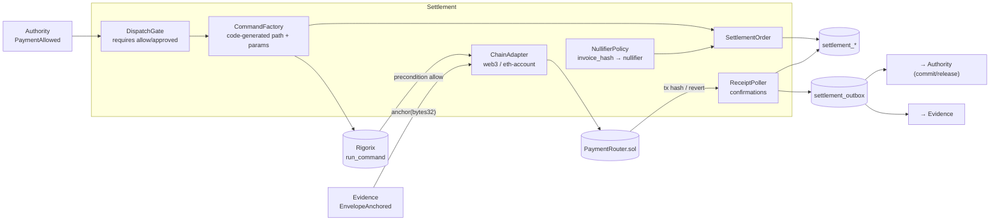
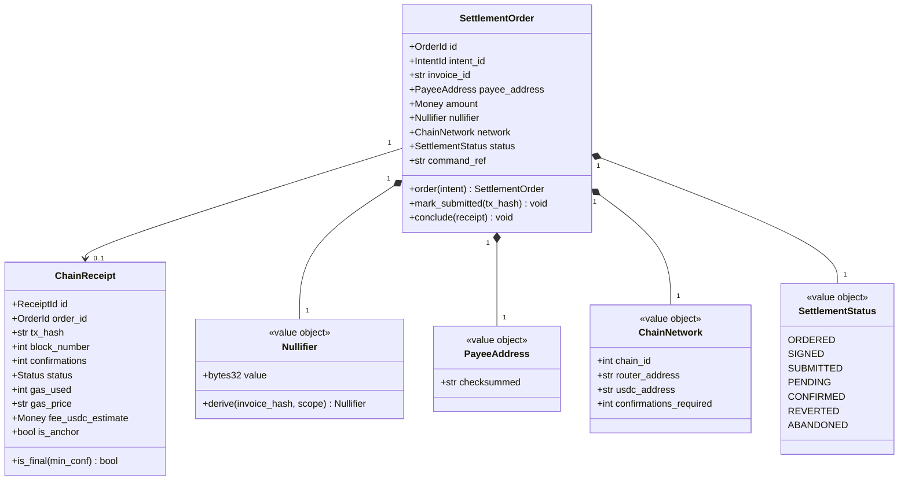
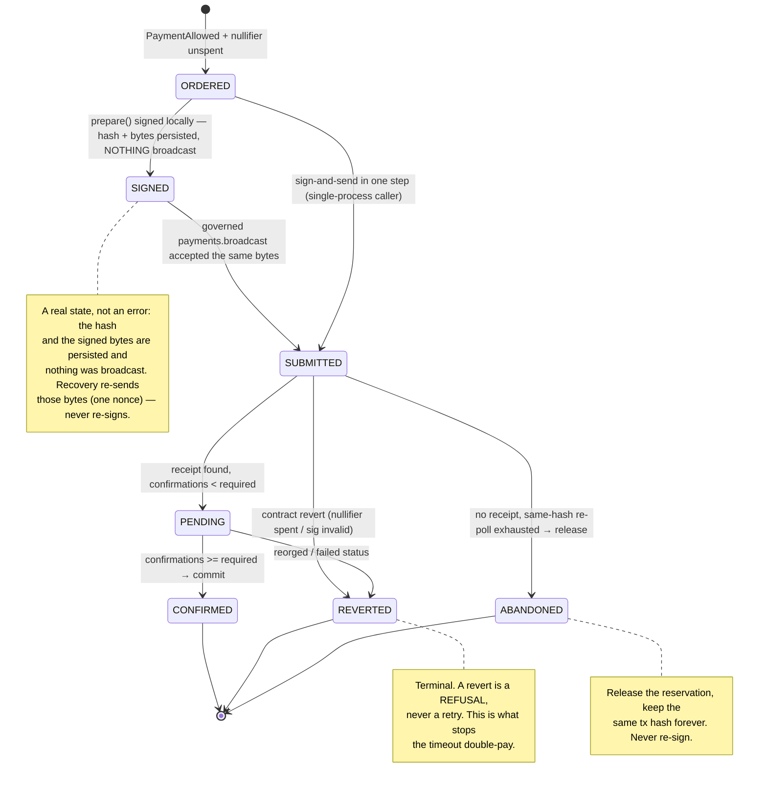
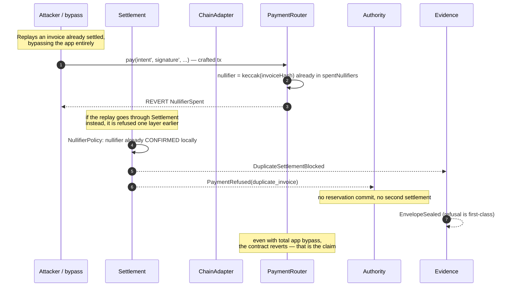

# Settlement

## Module Status

**Status:** Implemented
**Contract:** Frozen v1.0.0 — see [`docs/contracts/settlement-contract-freeze.md`](../../docs/contracts/settlement-contract-freeze.md)
**Depends:** Authority (allow/approved determination), Mandate (payee address via intent)
**Used by:** Evidence, Console
**Last reviewed:** 2026-11-15
**Source session:** 432050ea-0419-44ba-8ac4-b239242634b4

### Implementation status (2026-11-15)

Domain, persistence, the read API and the **write path's first half** are implemented. A dispatch now
signs locally, persists the hash and the signed bytes, and only then lets the governed step broadcast —
so SC-3's write-ahead ordering is real. What is still missing is everything after "broadcast accepted":
`SettleOnce` and the `PENDING`/`ABANDONED` transitions (blocker B-2).

| Surface | State |
|---|---|
| Domain (`SettlementOrder`, `ChainReceipt`, `Nullifier`, `ChainNetwork`, `NullifierPolicy`, `FinalityPolicy`) | Implemented — all 80 frozen suites green, plus `mark_signed`/`SIGNED` |
| Persistence (`settlement_orders/_nullifiers/_receipts/_outbox`) | Implemented — migrations `003_settlement` + `005_settlement_signed` (the `signed` state and the signed bytes), 7 SQLite integration tests |
| Read API (orders, receipts, cost, nullifier status) | Wired into `console-api` (ADR-009) — 9 E2E tests |
| `DispatchPayment` | **Implemented** — live gate (SC-1), local signing (SC-3), write-ahead hash + bytes, governed broadcast (SC-2), then `SUBMITTED`; a refused broadcast leaves the order `signed` |
| `SettleOnce` | **Deferred** — blocker B-2 (`PENDING`/`ABANDONED` have no intention method), see ADR-009 |
| `PaymentRouter.sol` + `ChainGateway`/`PaymentExecutor` adapters | **Built, not deployed** — contract + `Web3ChainGateway` (prepare/broadcast, receipts, nullifier reads) + `RigorixCommandAdapter` + `payments.broadcast`; no Anvil/Sepolia deployment and no funded key in this environment |
| `POST /v1/anchors` | **`501`** — needs a deployed router; the adapter exists |

Amendments made during implementation are recorded here because the freeze file is not edited after the
fact (see also its §7):

1. `SettlementOrder` carries `bank_digest`, `is_new_payee` and `requires_owner_signature` (copied from the
   intent). `command_params` must return the digest and the escalation bits; the module-doc stub already
   read them from the order (`self.intent_bank_digest`), but the frozen §2.3 sketch omitted the fields.
2. The nullifier seed is the invoice **identity** (`invoice_id`), not Billing's content hash. A content
   hash changes when a bill is re-issued, which would mint a second nullifier for one invoice and defeat
   scenario 6. `Nullifier.derive` documentes the derivation; the frozen test pins `order.invoice_id`.
3. **`ChainGateway` is two-phase** (`prepare` → `SignedPayment`, then `broadcast`), and `SettlementStatus`
   gained `SIGNED` with `SettlementOrder.mark_signed`. Blocker **B-1 is closed**: SC-3's
   persist-before-broadcast is now expressible, because signing is local and the hash exists before
   anything is sent. `SettlementOrder.command_ref` is still the module constant `payments.dispatch`
   (SC-2 — the settlement command's identity); the command it renders is
   `payments.broadcast --raw-tx <hex>`, and `CommandAck.command_text` records the rendered text.
4. `DispatchPayment` signs **before** it inserts the order row. If signing refuses, nothing is persisted:
   an `ORDERED` row would occupy the intent's only dispatch slot (`uq_settlement_orders_intent`) for a
   payment that was never signed.

The remaining write-path blocker is a contract change, never an agent's decision — a human unfreezes,
reviews and re-freezes: **B-2** `SettlementStatus.PENDING`/`ABANDONED` exist but `SettlementOrder` has no
intention method to enter them, so `SettleOnce` and finality are still unimplemented and an order stops
at `SUBMITTED`.

## Description

Moves USDC and proves it happened exactly once. Owns the Rigorix `run_command` dispatch, the
`PaymentRouter.sol` interaction, the nullifier, and the receipt that reconciles the off-chain
ledger with the chain.

This is **Lock 3** — the commit-point lock. Even a stolen operator key cannot make it pay a
payee the contract rejects, exceed the signed amount, or pay the same invoice twice, because
the refusal happens inside the transaction.

**Modeling Depth:** tactical (core domain)
**Subdomain Rationale:** The on-chain second lock and exactly-once settlement is the second half of the safety claim.
**Context Map:** Settlement → Authority (partnership) (Settlement may only execute an order derived from an allow determination; both sides co-evolve around the intent_id contract and the commit-or-release outcome.); Settlement → Mandate (conformist) (Settlement uses the payee address carried on the PaymentIntent, which originates from Mandate's verified bank digest — never from invoice text.); Settlement → Evidence (partnership) (Settlement publishes receipts and reverts for enveloping and asks Evidence to anchor the hash; anchoring is the shared on-chain write both contexts name 'anchor'.)

## Architecture

| Layer | Responsibility |
|-------|--------------|
| **Domain** | `SettlementOrder`, `ChainReceipt`, `Nullifier`, `PayeeAddress`, `ChainNetwork`, `SettlementStatus`, repository interfaces, `NullifierPolicy` | `src/settlement/domain/` |
| **Application** | `DispatchPayment`, `SettleOnce`, reconciliation | `src/settlement/application/` |
| **Infrastructure** | SQLAlchemy models/mappers/repositories + outbox writer (implemented); Rigorix `run_command` client and `payments.broadcast` (implemented); web3/eth-account adapter with `prepare`/`broadcast`, contract ABI, receipt reads (implemented, undeployed); receipt poller for `SettleOnce` (deferred — B-2) | `src/settlement/infrastructure/` |
| **Interfaces** | REST handlers (orders, receipts, cost, nullifier status, dispatch — live); anchors answer 501 naming the undeployed router (G-2); event subscribers (`PaymentAllowed`) deferred | `src/settlement/interfaces/` |

## Contract Freeze

The frozen contract for this module lives in
[`docs/contracts/settlement-contract-freeze.md`](../../docs/contracts/settlement-contract-freeze.md).
That file is the checkable form of the components and Acceptance Criteria below; implementation PRs
reference it, and a change to a frozen signature is a contract change (unfreeze → review → re-freeze),
not a refactor.

Contract ids map one-to-one to the Acceptance Criteria rows:

| Contract id | AC row | Rule |
|---|---|---|
| SC-1 | 1 | order only from a determination that permits dispatch |
| SC-2 | 2 | command path is the `payments.dispatch` module constant |
| SC-3 | 3 | write-ahead tx hash; one hash per order |
| SC-4 | 4 | `conclude` exactly once |
| SC-5 | 5 | nullifier derived locally and refused when spent |
| SC-6 | 6 | on-chain replay reverts; app records a refusal |
| SC-7 | 7 | finality from the network's confirmation count |
| SC-8 | 8 | a revert is terminal, never a retry; one event per order |
| SC-9 | 9 | submitted amount equals the signed intent amount |
| SC-10 | 10 | every receipt records gas/fee; cost derives from receipts only |
| SC-11 | 11 | Anvil and Sepolia never share chain id/router/USDC |
| SC-12 | 12 | `domain/` imports no web3/httpx/fastapi; refusals are shared `RefusalError`s |

Frozen surface in `src/settlement/`: `domain/` (values, views, errors, `SettlementOrder`,
`ChainReceipt`, services, repositories, ports, events), `application/` (six service ABCs + DTOs).
`infrastructure/` now holds the SQLAlchemy models/mappers/repositories and the outbox writer;
`interfaces/http/` holds the concrete router. The chain and Rigorix adapters remain deferred (ADR-009).

Three decisions in the contract amend or sharpen this document, and the contract file wins if they ever
disagree:

1. **`SettlementOrder.command_ref` is a `ClassVar`, not a dataclass field.** The stub above shows a field
   with a default; a field would let a caller pass a command path, which AC-2 says must be impossible
   (S-5).
2. **`PayeeAddress` is Mandate's value object**, not a Settlement type. Settlement is conformist to
   Mandate (context map); a second address type would let one side accept a destination the other
   rejects.
3. **`PaymentIntentView` / `DeterminationView` are frozen read models** for the factory signature below.
   `PaymentIntentView` adds `invoice_hash` and `household_id`, which Authority's aggregate does not
   store; Phase B assembles the view in the application layer. The nullifier seed is the invoice
   **identity** (`invoice_id`, see the implementation-status note), not the content hash.

Entry point for verification: `pytest backend/tests` (the settlement contract, HTTP and integration
suites, including the two-phase port and the governed broadcast step).

Runtime decision: [ADR-009](../decisions/ADR-009-runtime-wiring-multilang-judgment.md) (Accepted) — what
is wired, why the write path is deferred, and the B-1/B-2 re-freeze list.
## Related ADRs

| ADR | Relevance |
|---|---|
| [ADR-001](../decisions/ADR-001-architecture-pattern.md) | Settlement sits inside the console-api process; the chain adapter is infrastructure, not a context. |
| [ADR-002](../decisions/ADR-002-data-storage-strategy.md) | `settlement_*` tables; the nullifier uniqueness constraint is a database guarantee. |
| [ADR-003](../decisions/ADR-003-cross-context-communication.md) | Consumes `PaymentAllowed`/`ApprovalGranted`; publishes `SettlementConfirmed`/`SettlementReverted`. |
| [ADR-006](../decisions/ADR-006-cost-tracking-usage-metering.md) | `ChainReceipt` carries gas/fee; `CostSummary` is derived, never a competing balance. |
| [ADR-007](../decisions/ADR-007-compliance-engine-architecture.md) | `run_command` with a code-generated path; the contract is the final arbiter. |
| [ADR-009](../decisions/ADR-009-runtime-wiring-multilang-judgment.md) | Runtime wiring: read surface installed in the composition root; the write path is deferred on contract blockers B-1/B-2. |

## Diagrams

### Data Flow



### Entity Relationship



### Aggregate State — SettlementOrder



### Key Use Case Sequence — duplicate invoice (scenario 6)



## Components

### Aggregate: SettlementOrder

```python
# src/settlement/domain/settlement_order.py
"""Canonical: docs/architecture/modules/settlement.md#aggregate-settlementorder
Reference: docs/architecture/decisions/ADR-007-compliance-engine-architecture.md"""

from dataclasses import dataclass

# The command path is a module constant, generated by code — never by an LLM.
PAYMENT_COMMAND = "payments.dispatch"


@dataclass
class SettlementOrder(AggregateRoot):
    id: OrderId
    intent_id: IntentId
    invoice_id: str
    payee_address: PayeeAddress  # from the intent, frozen here
    amount: Money
    nullifier: Nullifier
    network: ChainNetwork
    status: SettlementStatus
    command_ref: str = PAYMENT_COMMAND

    @classmethod
    def order(
        cls, intent: PaymentIntentView, network: ChainNetwork, determination: DeterminationView
    ) -> "SettlementOrder":
        if not determination.permits_dispatch():  # S-1
            raise DispatchWithoutAuthority(determination.verdict)
        return cls(
            id=OrderId.new(),
            intent_id=intent.id,
            invoice_id=intent.invoice_id,
            payee_address=intent.payee_address,  # S-2 frozen from intent
            amount=intent.amount,
            nullifier=Nullifier.derive(intent.invoice_hash, intent.household_id),
            network=network,
            status=SettlementStatus.ORDERED,
        )

    def command_params(self) -> dict:
        """Structured params for run_command. Generated here, never accepted from a caller."""
        return {
            "intent_id": self.intent_id.value,
            "invoice_id": self.invoice_id,
            "payee": self.payee_address.value,
            "payee_address": self.payee_address.value,
            "amount_usdc": self.amount.micro_usdc,
            "bank_digest": self.intent_bank_digest,  # carried from the intent
            "is_new_payee": self.intent_is_new_payee,
            "requires_owner_signature": self.intent_requires_signature,
            "command": self.command_ref,
        }

    def mark_submitted(self, tx_hash: str) -> None:
        if self.status is not SettlementStatus.ORDERED:  # S-3
            raise IllegalTransition(self.status, "SUBMITTED")
        self.tx_hash = tx_hash  # persisted BEFORE broadcast (write-ahead)
        self.status = SettlementStatus.SUBMITTED
        self.record(SettlementSubmitted(order_id=self.id, tx_hash=tx_hash))

    def conclude(self, receipt: ChainReceipt) -> None:
        if self.status in (
            SettlementStatus.CONFIRMED,
            SettlementStatus.REVERTED,
            SettlementStatus.ABANDONED,
        ):  # S-4
            raise OrderAlreadyConcluded(self.id)
        if receipt.confirmed:
            self.status = SettlementStatus.CONFIRMED
            self.record(
                SettlementConfirmed(
                    order_id=self.id, tx_hash=receipt.tx_hash, confirmations=receipt.confirmations
                )
            )
        else:
            self.status = SettlementStatus.REVERTED
            self.record(
                SettlementReverted(
                    order_id=self.id, tx_hash=receipt.tx_hash, revert_reason=receipt.revert_reason
                )
            )
```

**Invariants (aggregate-local):**
| # | Rule | Prevents |
|---|---|---|
| S-1 | An order is creatable only from a determination whose verdict permits dispatch (`allow`, or `escalate` that became `ApprovalGranted`). | Dispatching a payment that was never authorised. |
| S-2 | `payee_address`, `amount` and `nullifier` are copied from the intent and immutable afterwards. | Late destination substitution between authorization and signature. |
| S-3 | The tx hash is persisted **before** broadcast; an order never gets a second hash. | A retry generating a new nonce and paying twice. |
| S-4 | An order concludes exactly once; a concluded order cannot be re-concluded, re-dispatched or reset. | Error paths that resurrect a duplicate payment. |
| S-5 | `command_ref` is the module constant; no caller may supply a command path. | An injection redirecting the settlement command. |
| S-6 | A revert is terminal and maps to a refusal, never to a retry. | The timeout double-pay. |

### Value Objects (entity-vs-VO justification)

| VO | Justification | Not an entity because |
|---|---|---|
| `Nullifier` | `keccak(invoice_hash, mandate scope)`; its only property is that it can be spent once. | Two equal nullifiers are the same marker — nothing to track. |
| `PayeeAddress` | Checksummed EVM address; validated at construction. | An address is a value; identity lives on `Payee`. |
| `ChainNetwork` | chain id + router + USDC + confirmations, bound together. | A network configuration, not a thing with a lifecycle. |
| `SettlementStatus` | Closed set of six states. | An enum. |

### Repository interfaces (owned by `domain/`)

```python
# src/settlement/domain/repositories.py
"""Canonical: docs/architecture/modules/settlement.md#components"""


class SettlementOrderRepository(ABC):
    @abstractmethod
    async def find_by_id(self, id_: OrderId) -> SettlementOrder | None: ...
    @abstractmethod
    async def find_by_intent(self, intent_id: IntentId) -> SettlementOrder | None: ...
    @abstractmethod
    async def save(self, order: SettlementOrder) -> None: ...


class NullifierRepository(ABC):
    @abstractmethod
    async def is_spent(self, nullifier: Nullifier) -> bool: ...
    @abstractmethod
    async def spend(self, nullifier: Nullifier, order_id: OrderId) -> None:
        """Raises DuplicateNullifier on unique violation — the DB is the last local lock."""


class ChainReceiptRepository(ABC):
    @abstractmethod
    async def append(self, receipt: ChainReceipt) -> None: ...
    @abstractmethod
    async def find_by_order(self, order_id: OrderId) -> ChainReceipt | None: ...
```

### Ports (infrastructure adapters)

| Port | Adapter | Note |
|---|---|---|
| `PaymentExecutor` | `RigorixCommandAdapter` | Calls `run_command` with `SettlementOrder.command_params()`. The one command is `payments.broadcast --raw-tx <hex>`; an order with no signed bytes is refused before the host is contacted. |
| `ChainGateway` | `Web3ChainGateway` | **Two-phase**: `prepare(order) -> SignedPayment` signs `PaymentRouter.pay(...)` locally (hash known, nothing sent, `SecondTransactionRefused` / owner-signature refusal), then `broadcast(signed)` sends those exact bytes. Also polls receipts and reads `spentNullifiers`. |
| `DeterminationGate` | `AuthorityHttpAdapter` | Verifies an allow/approved determination exists for the intent **right now**. |

The governed broadcaster is a console script, not a second payment path:
`payments.broadcast --raw-tx <hex>` (`src/settlement/infrastructure/chain/broadcast_cli.py`). It takes one
option and has no database, no order lookup, no network re-derivation and no signer.

### Domain Services

| Service | Why not on an aggregate |
|---|---|
| `NullifierPolicy` | Derives the nullifier from the invoice hash + mandate scope and decides local refusal before any chain call; used by `SettleOnce`. |
| `FinalityPolicy` | Decides when a receipt is final per `ChainNetwork.confirmations_required`; belongs to neither aggregate. |

## Domain Events

| Event | Description | Trigger | Payload | Published By | Expert cares | Crosses boundary | Audit |
|---|---|---|---|---|---|---|---|
| `SettlementOrdered` | An allowed intent became an executable order with its nullifier. | DispatchPayment | `order_id, intent_id, invoice_id, nullifier, amount_usdc, network` | Settlement | ✅ | ✅ | ✅ |
| `SettlementSubmitted` | Transaction broadcast; a tx hash exists. | DispatchPayment | `order_id, tx_hash, nonce` | Settlement | ❌ | ❌ | ✅ |
| `SettlementConfirmed` | Receipt reached required confirmations — the only event that commits cap. | SettleOnce | `order_id, intent_id, tx_hash, block, confirmations, amount_usdc` | Settlement | ✅ | ✅ | ✅ |
| `SettlementReverted` | Contract rejected the tx (duplicate nullifier, bad signature). Treated as refusal. | SettleOnce | `order_id, intent_id, tx_hash, revert_reason` | Settlement | ✅ | ✅ | ✅ |
| `DuplicateSettlementBlocked` | Nullifier already spent, locally or on-chain; nothing moved. | SettleOnce | `intent_id, invoice_id, nullifier, detected_at` | Settlement | ✅ | ✅ | ✅ |
| `NullifierSpent` | The invoice's once-only marker is consumed for this scope. | SettleOnce | `nullifier, order_id, invoice_id` | Settlement | ✅ | ❌ | ✅ |
| `ReceiptAnchored` | A settlement receipt or evidence hash was written on-chain. | SealEvidence | `anchor_tx, anchored_hash, order_id` | Settlement | ✅ | ✅ | ✅ |

## Application Services

| Service | Use case | Maps to FR |
|---------|----------|-----------|
| `DispatchPayment` | Executes the allow-determined order through Rigorix run_command with a code-generated command path, then submits the PaymentRouter transaction. | FR-019 |
| `SettleOnce` | Enforces exactly-once settlement by deriving the invoice nullifier, rejecting local duplicates and relying on the contract revert as the final lock. | FR-021 |

Below the catalog: `GetReceipt`, `ListOrders`, `AnchorHash` (used by Evidence), `CostSummary`.

## API Endpoints

| Method | Path | Handler | Input | Output | Auth |
|---|---|---|---|---|---|
| POST | `/v1/intents/{intent_id}/dispatch` | `interfaces/api.dispatch` | `Idempotency-Key` | order + tx hash | `settlement:read` (internal) |
| GET | `/v1/orders/{id}` | `interfaces/api.get_order` | — | order + status | `settlement:read` |
| GET | `/v1/orders/{id}/receipt` | `interfaces/api.get_receipt` | — | receipt (tx, block, confirmations, gas, fee) | `settlement:read` |
| GET | `/v1/receipts` | `interfaces/api.list_receipts` | `?day=` | receipts + `CostSummary` | `settlement:read` |
| GET | `/v1/nullifiers/{value}` | `interfaces/api.nullifier_status` | — | `{spent, order_id}` | `evidence:read` |
| POST | `/v1/anchors` | `interfaces/api.anchor` | `hash` | anchor tx | internal (Evidence) |

## Ubiquitous Language

| Term | Definition |
|------|-----------|
| settlement | The confirmed on-chain movement of USDC from the household account to a payee address under one nullifier. |
| settlement order | The immutable executable form of an allowed intent, carrying payee address, amount, nullifier and the code-generated command reference. |
| nullifier | Derived once-only marker from the invoice hash; the on-chain anti-double-pay key. Spending it twice is impossible by construction. |
| receipt | The chain proof for an order: tx hash, block, confirmations, status, and the anchor written for its evidence envelope. |
| commit-point lock | The property that PaymentRouter, not the app, is the final gate: whatever the off-chain state, a bad payment cannot be mined. |
| confirmation | Blocks mined after the transaction's inclusion; only after the required count is the settlement final and the cap committed. |
| run_command | The Rigorix payment step: a fixed command path plus structured params generated by code from the intent. |
| revert | On-chain rejection of a settlement, most often a duplicate nullifier or a failed signature check. Always a refusal with evidence, never a retry. |
| anchor | The on-chain write of an envelope hash that gives tamper evidence an independent timestamp. |

## Dependencies

### Depends On

| Module | What it provides |
|---|---|
| **Authority** | `PaymentAllowed` / `ApprovalGranted` (dispatch gate) and the `intent_id` contract; reconciliation returns to `ReconcileReservation`. |
| **Mandate** | The payee address as frozen on the intent — read once, never re-read at submit time (conformist). |

### Used By

| Consumer | What it needs |
|---|---|
| **Evidence** | `SettlementConfirmed` / `SettlementReverted` to envelope, and `POST /v1/anchors` to anchor hashes. |
| **Authority** | Settlement outcome → commit or release the reservation. |
| **Console** | Receipt read model, explicitly labeled as real chain settlement. |

## Implementation Sequence

Status as of 2026-11-14: 1, 2, 5 and 9 are done; 3, 4, 6, 7 and 8 are deferred (ADR-009).

1. ✅ `ChainNetwork` (Anvil + Base Sepolia configs), `PayeeAddress`, `Nullifier` + derivation test.
2. ✅ `SettlementOrder` with S-1…S-6 and the write-ahead hash test.
3. 🟡 `PaymentRouter.sol`: nullifier map, EIP-712 check, anchor event — built and exercised on an
   in-process EVM; **not deployed** to Anvil/Base Sepolia (gap G-2, operational).
4. 🟡 `ChainGateway` adapter: `prepare`/`broadcast`, receipts, revert reasons — built and tested end to
   end against `eth-tester`; no deployed router address and no funded signer (gap G-1, operational).
5. ✅ `NullifierRepository` with unique constraint; local duplicate test (scenario 6, app path).
6. ✅ `DispatchPayment`: live gate → `prepare` → persist hash + signed bytes (`signed`) → governed
   `payments.broadcast` → `SUBMITTED` (B-1 closed by the two-phase port).
7. ⏸ `SettleOnce` + `FinalityPolicy` on the live path; on-chain duplicate test — gap B-2.
8. ⏸ Publish `SettlementConfirmed`/`SettlementReverted` → Authority reconciliation — follows 6/7.
9. ✅ `AnchorHash` + `CostSummary` (ADR-006) — service implemented; the chain write is gap G-1.

## Patterns & OOP Mapping

| Component | Pattern | Rationale |
|---|---|---|
| `SettlementOrder.order` | **Factory + guarded construction** | Enforces S-1 (authority required) at the only entry point. |
| `PaymentExecutor` / `ChainGateway` | **Ports & Adapters (Strategy)** | Two networks (Anvil/Sepolia) and a fake for tests are genuine variants — the interface is earned, not speculative. |
| `NullifierPolicy` / `FinalityPolicy` | **Domain services** | Cross-cutting rules that belong to neither aggregate. |
| State machine on `SettlementOrder` | **Explicit transitions** | S-3/S-4 exist to make double-submission unrepresentable. |
| Write-ahead tx hash | **Idempotent side-effect ordering** | Persist the intent-to-send before sending; the only anti-double-pay ordering that survives a crash. |
| Events | **Observer (outbox)** | Authority must learn the outcome even if it is down. |

## Acceptance Criteria

| # | Component | Criterion | Verify In |
|---|---|---|---|
| 1 | `SettlementOrder.order` | Without an allow/approved determination → `DispatchWithoutAuthority`, nothing persisted. | unit |
| 2 | `command_params` | Returns the fixed `payments.dispatch` path (whose rendered command is `payments.broadcast --raw-tx <hex>`); a caller supplying a path is impossible via the API (no field exists). | unit |
| 3 | Write-ahead hash | `prepare` signs locally, the hash and bytes are persisted at `mark_signed` (status `signed`), and only then does the governed step broadcast. Killing the process after that leaves a hash to re-poll and bytes to re-send; no second tx is ever signed. A refused broadcast keeps the order `signed` with its hash. | unit + integration |
| 4 | `conclude` | Second call raises `OrderAlreadyConcluded`. | unit |
| 5 | Nullifier local | Replay of a settled invoice through the API → `DuplicateSettlementBlocked`, zero transactions. (scenario 6) | integration |
| 6 | Nullifier on-chain | Direct contract call replaying a spent nullifier reverts; app records `SettlementReverted`. (scenario 6) | integration (Anvil) |
| 7 | Finality | 0 confirmations → `PENDING`, no cap commit; required confirmations → `CONFIRMED` + commit. | integration |
| 8 | Revert = refusal | A reverted order never retries; exactly one outbox `SettlementReverted` per order. | integration |
| 9 | Amount integrity | Submitted amount equals the signed intent amount; a mismatch is impossible by construction and asserted. | integration |
| 10 | Receipt cost | Every receipt records gas_used, gas_price and fee estimate; `CostSummary` derives from receipts only. | integration |
| 11 | Network config | Anvil run and Sepolia run use their own chain id/router/USDC; no hardcoded address leaks between them. | unit |
| 12 | Layer purity | `src/settlement/domain/` imports no web3/httpx/fastapi. | automated |

## Modeling Depth Note (ADR-008)

Core subdomain — full tactical depth: one aggregate root, three value objects, two entities
(`ChainReceipt`, plus the embedded `SettlementStatus` lifecycle), two domain services, two
catalog application services, seven triaged events, `domain/`-owned repositories and explicit
ports for the chain and Rigorix adapters.

## Open Questions

- Anchor batching policy vs per-envelope anchoring for the demo (ADR-006 default: batched, demo
  scenarios per-envelope).
- Sepolia confirmation count for "final" on demo day (proposed 2, needs confirmation).
- Whether `ABANDONED` should exist at all, or whether a missing receipt should stay `PENDING`
  until an operator resolves it.

---

**Canonical:** `docs/architecture/modules/settlement.md`
**Last updated:** 2026-11-13